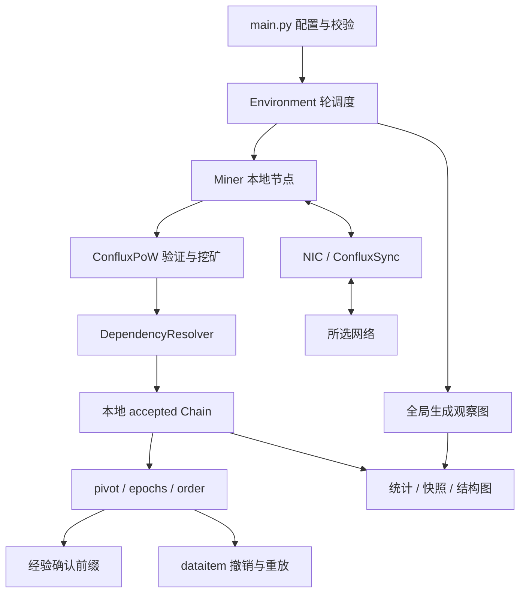
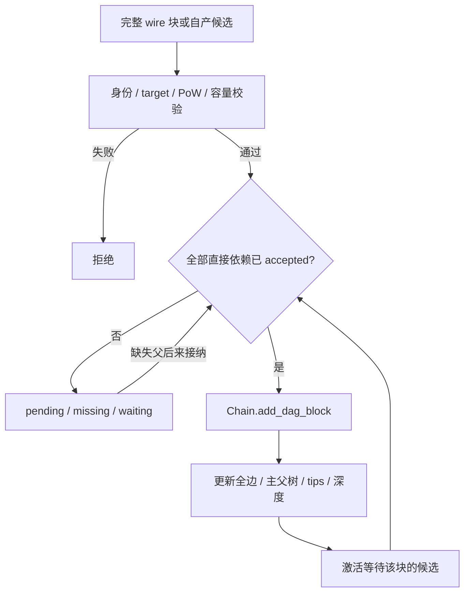

# 全诚实节点 Conflux DAG 开发指南

本指南介绍 ChainXim 中基于 PoW 的 Conflux blockDAG 扩展：如何在原有模块中保存多父区块、完成依赖接纳、选取 pivot、划分 epoch、生成全序，并通过不同网络运行和分析仿真。协议配置为 `conflux_2018_v4`，采用 Conflux 2018 论文的 pivot 树与 epoch 排序框架；区块编码、网络和应用层采用本项目的仿真定义，不与 Conflux 主网通信格式兼容。

当前 DAG 路线支持 `consensus.ConfluxPoW`、全诚实节点和五种网络，支持抽象 dataitem、可撤销的深度确认、结构图、指标和离线重放。原单链的共识、攻击模块、配置与输入输出仍保留，使用说明见[原开发指南](developer-guide.zh.md)和[仿真实例](simulation-example.zh.md)。本指南集中说明 DAG 新增或改变的部分。

## 1. 运行入口与总体结构

### 1.1 最小运行

在仓库根目录、已安装 [requirements.txt](requirements.txt) 中依赖的 Python 环境下运行：

```bash
python main.py --config conf/conflux_lockstep.ini \
  --miner_num 4 --total_round 80 --q_ave 1 --difficulty 3 --blocksize 0.1 \
  --confirmation_policy pivot_depth -N 2 --seed 7 \
  --no_compact_outputfile --result_path Results/dag_example
```

该命令使用同步广播网络，保存全局图、默认节点0本地图和完整重放材料。保存 SVG 需要安装系统 Graphviz，并使 `dot` 可执行文件位于 PATH；Python 的 `graphviz` 包负责调用它。`--show_fig` 只控制交互显示，保存结构图不需要开启它。无图形界面的环境可先设置 `export MPLBACKEND=Agg`。

省略 `--no_compact_outputfile` 时，基础配置采用精简输出，仍保留核心指标和文本结果。默认 `system_config.ini` 是原单链配置，运行 DAG 时应显式选择 `conf/conflux_*.ini`。

### 1.2 与原单链骨架的关系

扩展继续使用 `main → Environment → Miner → Consensus → Chain → NIC/Network`。每个矿工拥有自己的 `ConfluxPoW`、`Chain`、依赖缓存和应用状态；节点只使用本地已接纳区块做决策。



`Environment.global_chain` 记录真实生成过的区块，供全局绘图与统计使用。它不是供矿工共享的共识图，不能给节点补父块、选父或决定排序。

| 原单链职责 | DAG 中的对应处理 |
|---|---|
| `Block` 保存前置父区块 | 保留唯一主父 `prehash`，增加引用父 `refhashes` |
| `Chain` 保存链与分叉树 | 保存完整 accepted DAG，同时保留主父树索引 |
| 最长链选择 | 在主父树上按最重子树选 pivot；引用边用于 epoch 与排序 |
| 单父区块接纳 | 全部直接依赖齐全后接纳，缺失依赖进入 pending |
| 原 PoW 搜索 | 继续真实 SHA 尝试，改用 v2 规范编码及 DAG 模板 |
| 原 NIC 和网络传播 | 保留网络调度；拓扑网络增加依赖补块、分片去重与重连同步 |
| 主链应用顺序 | 按 epoch 全序应用；重组时撤销旧后缀、重放新后缀 |
| 原单链统计与输出 | 保留适用项；增加 DAG 指标，不适用的链指标注明原因 |

### 1.3 文件导航

下表区分原生模块中的扩展和 DAG 专用模块。`block_set` 始终是本节点唯一的已接纳 Block 对象表，索引、view 和性能缓存不建立第二份共识图。

| 文件 | 类型与职责 |
|---|---|
| [main.py](main.py) | 原生入口扩展：配置、CLI 覆盖、合法组合检查、种子初始化 |
| [environment.py](environment.py) | 原生调度扩展：挖矿轮、轮末接收、可选收尾、全局观察与输出 |
| [global_var.py](global_var.py)、[external.py](external.py) | 原生配置与输入接口扩展：路径、DAG 设置、抽象输入 |
| [data/block.py](data/block.py) | 原生类型扩展：保留 v1，增加 v2 头、引用、rank 与 wire 副本规则 |
| [data/chain.py](data/chain.py) | 原生存储扩展：DAG 索引、接纳、view、恢复及增量缓存生命周期 |
| [data/dag_events.py](data/dag_events.py) | DAG 专用：冻结的协议 view、排序差量和确认差量 |
| [consensus/consensus_abc.py](consensus/consensus_abc.py)、[consensus/pow.py](consensus/pow.py) | 保留原共识接口和 PoW 单链基线，接入版本化编码 |
| [consensus/conflux.py](consensus/conflux.py) | DAG 共识入口：模板、挖矿、验证、依赖接纳及批末更新 |
| [consensus/conflux_codec.py](consensus/conflux_codec.py) | DAG 专用：v2 编码、固定创世、hash 与规范身份检查 |
| [consensus/dependency.py](consensus/dependency.py) | DAG 专用：缺父候选、等待索引及级联接纳 |
| [consensus/conflux_protocol.py](consensus/conflux_protocol.py) | DAG 专用：权重、pivot、epoch、批次拓扑排序及增量计算 |
| [consensus/conflux_confirmation.py](consensus/conflux_confirmation.py) | DAG 专用：可撤销的 `pivot_depth` 确认 |
| [miner/miner.py](miner/miner.py) | 原生节点扩展：生命周期、接纳时间、应用与观察边界 |
| [miner/conflux_dataitems.py](miner/conflux_dataitems.py) | DAG 专用：数据项池、引用计数、排序撤销/重放及确认投影 |
| [miner/network_interface](miner/network_interface) | 原 NIC 扩展；`conflux_sync.py` 处理库存、补块、分片与重连 |
| [network](network) | 保留原网络类；DAG 使用第4节所述的五种网络 |
| [util/dag_metrics.py](util/dag_metrics.py)、[util/dag_analysis.py](util/dag_analysis.py) | DAG 指标、传播样本、缺父状态及节点汇总 |
| [util/dag_output.py](util/dag_output.py)、[util/dag_plot.py](util/dag_plot.py) | DAG 文本、JSON、快照与双视角结构图 |
| [util/dag_audit.py](util/dag_audit.py)、[util/dag_replay.py](util/dag_replay.py) | 实际输入审计、图恢复、文件核对和离线重放 |
| [plot_honest_dag.py](plot_honest_dag.py) | 离线吞吐比较、DAG 特征和时序绘图，不执行仿真 |
| [conf](conf) | 五种网络配置、确认/数据项示例和原单链配置 |

## 2. 核心数据结构与依赖接纳

### 2.1 Block、编码与本地元数据

保留原 `Message → Block` 继承结构及共识类的嵌套 `BlockHead/Block`。单链默认使用 `header_version=1`；Conflux 显式使用`header_version=2`，新增构造字段不改变原位置参数的含义。

| 字段 | 类型 | 含义 |
|---|---|---|
| `header_version` | int | DAG 固定2 |
| `prehash` | bytes(32) | 唯一主父 hash；创世为全零 |
| `refhashes` | tuple[bytes, ...] | 按 hash 升序的引用父，不能重复或包含主父 |
| `miner` / `timestamp` | i32 / u64 | 生产者编号 / 逻辑挖矿轮；创世为 −1 / 0 |
| `target` / `nonce` | bytes(32) / u32 | 本次仿真固定 PoW 目标 / 搜索计数，nonce 不允许溢出回绕 |
| `content` | bytes | 正文；启用数据项时为8字节项的拼接 |
| `blockhash` | bytes(32) | 完整 v2 规范编码的 SHA-256 |
| `parentblock` / `next` | Block / list[Block] | 本地主父树父/子连接，不表达引用边 |
| `height` / `dag_rank` | int | 接纳后计算的主父深度 / 全部依赖最长路径深度 |
| `name` | str | `B0` 为创世，`B1…` 为仿真生成编号，不是高度或协议顺序 |

每个普通块写入一个主父和零至多条引用父，**只记录直接依赖，不写入所有历史块**。深度定义为：

```text
height(b) = height(main_parent(b)) + 1
rank(b)   = 1 + max(rank(p) for p in all_direct_parents(b))
```

创世两者均为0。远端普通块的 height/rank 不作为可信输入，依赖齐全后由本节点重算。

[conflux_codec.py](consensus/conflux_codec.py) 按以下字段进行 big-endian 编码：

```text
DOMAIN(17) = b"CHAINXIM-CONFLUX\0"
|| version:u16 || miner:i32 || timestamp:u64 || prehash:32B
|| ref_count:u32 || refhashes:(32B × ref_count)
|| target:32B || content_length:u32 || content || nonce:u32
```

总长度为 `107 + 32×引用数 + len(content)` 字节。固定创世采用 version=2、miner=−1、timestamp=0、零主父、无引用、全FF目标、空正文、nonce=0，因此编码恰好107字节。创世不挖矿，也不计入普通块吞吐。

`height、rank、epoch、name、size、parentblock/next` 不参与协议身份编码。接收端要求引用本身已规范化，不通过修改收到的头来“修复”身份。wire 深复制会断开本地父子指针，防止网络消息免费携带祖先target图。

### 2.2 Chain：完整图、主父树与协议投影

| 字段 | 不变量 |
|---|---|
| `block_set` | hash → 本地唯一 accepted Block |
| `parents_by_hash` | hash → 直接依赖 tuple，主父在前；创世为空 |
| `children_by_hash` | hash → 全部主父/引用边的反向子集合 |
| `_dag_tips` | 没有任何 accepted 全边子块的 hash 集合 |
| `head` / `last_block` | 固定创世 / 当前已安装 pivot 尾 |
| `protocol_view` | 当前 pivot、epochs 和 order，仅保存 hash 序列 |
| `last_protocol_delta` | 上一次安装到当前安装的排序差量 |

一个块只要被后来区块 reference，就不再是全图 tip；不能用 `not block.next` 判断 DAG tips。`last_block` 也不表示最近生成或 rank 最大的块。

| 接口 | 返回与用途 |
|---|---|
| `add_dag_block(block, deepcopy=True)` | `(local_block, added)`；原子、幂等，要求依赖已接纳，维护全部索引 |
| `get_parent_hashes(hash)` | 全部直接依赖 |
| `get_main_children(hash)` | 按 hash 排序的主父树子块 |
| `get_tips()` | 完整 DAG 的本地 Block tuple |
| `get_past(hash, include_self=True)` | 沿全部父边的祖先闭包，默认包含自身 |
| `get_total_order()` | 当前已安装序中的 Block tuple，不触发重算 |
| `set_protocol_view(view)` | 公共严格验证与安装，更新 pivot 尾和差量 |
| `_refresh_protocol_view()` | 内部已验证接纳图的增量刷新入口 |

`add_dag_block` 检查身份、依赖、深度和索引一致性，但不代替共识层的 PoW 检查。外来候选应通过 `ConfluxPoW` 和 resolver，不能直接插入 `block_set`。

### 2.3 DependencyResolver：完整消息到正式接纳

`ConfluxPoW.valid_block` 验证规范身份、固定 target、`hash < target`、生产者范围，以及启用时的正文编码和容量。它不要求远端主父等于接收者当前 pivot。



| resolver 字段 | 作用 |
|---|---|
| `pending` | hash → 已验证但未依赖闭合的自有候选副本 |
| `missing` | child hash → 尚未 accepted 的直接父集合 |
| `waiting` | 缺失父 hash → 等待它的候选集合 |
| `_ready` / `_scheduled` | 就绪 hash 最小堆 / 调度去重集合 |

例如 C 依赖 A 和 B，先收到 C 时缓存；A 到达仍等待 B；B 接纳后 C 自动释放，等待 C 的后代继续级联。`submit(block)` 返回本次新接纳的本地块 tuple。重复输入不重复接纳，pending 不参与 tips、选父或排序。

“收到完整消息”“正式接纳”“进入全序”“获得确认”是不同状态。resolver 的就绪堆只确定稳定的接纳处理顺序，不定义账本全序；寻找和传输缺失区块由 NIC 负责。

## 3. 节点执行、排序、确认与应用

### 3.1 一轮怎样推进 DAG

`Environment` 仍按逻辑轮调度，不将 round 自动换算为秒。每轮主要顺序如下：

1. `on_round_start` 更新输入，向矿工提供 `INSERT`。
2. 各矿工执行 `BackboneProtocol`。`local_state_update(round)` 处理上一边界后的完整接收批次，级联接纳，再刷新本地 view、确认和应用状态。
3. 挖矿模板以本地 pivot 尾为主父，以其他全部 accepted tips 为 reference。pending 块不能作父。
4. 每节点最多进行 `ceil(q_i)` 次真实 SHA 尝试，首次成功停止，每轮最多自产一个块；`q_i=0` 不构造挖矿模板。失败后 nonce 延续，成功后重置。
5. 自产块经相同的验证和依赖接纳入口入图；更新协议、应用状态，并交给 NIC。Environment 记录生成事件。
6. 所有矿工完成本轮挖矿后，调用 `Network.diffuse(round)`；随后各节点 `process_received` 处理轮末完整消息，再做批末更新与观察。
7. 检查停止条件：达到 `total_round`，或节点0 pivot 高度超过 `total_height`。

Python 中顺序调用矿工不意味着后调用节点提前知道同轮其他节点的新块，网络传播位于挖矿之后。`receive_block` 的验证、去重和入接收带也不等于立即安装新全序；协议在对应处理边界统一更新。

当前模板没有 `max_parents` 参数或引用数量上限。仅有主父而无 reference，通常说明本地只知道一个 accepted tip；并发分支在传播后被看到，才可能进入后续区块的引用。

`local_state_update` 延续原共识接口，返回本地 `Chain`、本次排序重放加入的块和首次接纳/转发的块；`consensus_process` 执行自产尝试。转发集合与排序 added 是不同语义，不互相替代。

### 3.2 最重子树 pivot 与 epoch 全序

协议计算位于 [conflux_protocol.py](consensus/conflux_protocol.py)。设每个块权重为1，只沿**主父树**累计：

```text
W(b) = 1 + sum(W(c) for c in main_children(b))
next_pivot(b) = argmin_c (-W(c), hash(c))
```

从创世开始逐层选最重子树，并列选 hash 较小者，直到叶节点。reference 不增加子树权重，但参与依赖祖先关系。选择的是最重子树，不是最高 rank 或最长路径。

设 pivot 为 `P0…Pk`，其中 `P0` 是创世，`Past(b)` 包含 b 及沿全部父边可达的祖先：

```text
E0 = {P0}
Ei = Past(Pi) − Past(Pi−1), i ≥ 1
order = BatchOrder(E0) || BatchOrder(E1) || ... || BatchOrder(Ek)
```

`BatchOrder` 每次收集本 epoch 内依赖已满足的一整批 ready 块，按 hash 排序输出，然后再释放下一批。它不是“输出一个块便立刻从全局最小堆选下一个”的拓扑排序。两个实现都可能合法拓扑有序，但会产生不同的协议全序。

尚未进入 `Past(Pk)` 的 accepted 块保持未分配 epoch。即使所有节点已收到全部生成块，末轮并发旁支也可能不在 pivot 尾的 Past 中；需要后续区块将它纳入该 Past，不能在结束时强行分配 epoch。全局图也遵守相同定义。

### 3.3 冻结 view 与可撤销差量

[dag_events.py](data/dag_events.py) 的核心记录只保存 hash。以下为字段摘录，实际公共构造器还检查类型、无重复及拼接一致性：

```python
@dataclass(frozen=True, slots=True)
class ConfluxView:
    pivot: tuple[bytes, ...]
    epochs: tuple[tuple[bytes, ...], ...]
    order: tuple[bytes, ...]
```

安装 view 后，`Chain.last_block` 指向 pivot 尾。`ProtocolDelta` 保存 `old_order、new_order、common_prefix_length、removed、added`；removed 和 added 是最长共同前缀之后的两个后缀。

例如旧序 `[G,A,B,C]` 变为 `[G,A,C,B]`，撤销 `[B,C]`，重放 `[C,B]`。B、C 并未从图中删除，撤销的是应用顺序。两后缀可以包含相同块，故累计 added 长度不是唯一块数或吞吐量。差量应在本次协议安装后消耗，不能跳过多次更新后仅消耗最后一份。

### 3.4 确认与接收收尾

[conflux_confirmation.py](consensus/conflux_confirmation.py) 提供两种策略：

| `confirmation_policy` | 规则 |
|---|---|
| `none` | 关闭确认；pivot、epoch 和排序照常运行 |
| `pivot_depth` | 使用原参数 `-N`，当 `k−i ≥ N` 时，epoch i 进入当前确认前缀 |

深度按 pivot 位置计算，不按 rank、引用数量或经过轮数计算。N=0 时当前全序全部具备确认资格；深度不足时可没有普通确认块。当前确认前缀可随重组撤销、重排和再次确认，不是确定性终局，也未计算论文中的确认风险概率。

`ConfirmationTracker` 分开保存当前序、首次确认历史、变化事件和边界 `sequence`。`ConfirmationDelta.removed/added` 表示顺序后缀的撤销/重放，`revoked/newly_confirmed` 表示成员真正失去/获得资格，两者不能混算。

`drain_rounds` 默认0，显式开启后追加固定数量的仅接收/同步轮，不挖矿。吞吐分母仍为实际挖矿轮数 T，挖矿截止状态先冻结，观察结束状态另列。收尾不是论文协议步骤，也不保证网络队列必定排空或所有块获得 epoch/确认；迟到的已有块仍可改变 pivot。

### 3.5 抽象 dataitem 与在线重放

仅当 `dataitem_enable=True` 且 `max_block_capacity>0` 时启用打包。dataitem 为 `random_id:u32 || input_round:u32` 的8字节身份，模拟待打包内容；不实现账户、签名、UTXO 或真实交易执行。未启用时仍可用逻辑轮字节作为普通块 content。

| 输入模式 | 行为 |
|---|---|
| `dataitem_input_interval>0` | 在轮1、1+interval、…向节点提供公共输入，每节点维护本地待打包池 |
| `dataitem_input_interval=0` | 使用显式全局输入池，根据上一轮实际生成块已打包项更新输入；不等待排序或确认 |

后者是原平台的应用输入抽象，不是现实中的分布式交易池，也不是向节点共享全局区块图。两种模式均可配合任一种基础网络，无需更换专用 INI。

[ConfluxDataitemState](miner/conflux_dataitems.py) 区分已知输入、accepted 块中的打包记录、当前 ordered 项引用计数、当前确认项和待打包池。关键接口为 `ingest、select、synchronize、set_confirmed_order、summary/snapshot`。

排序改变时，`synchronize` 先按逆序撤销 removed 后缀，再顺序应用 added。某项被两个排序块重复包含时计数为2，撤销一个块不会让它重新待打包；只有当前全序中出现次数降至0，才可能返回池中。确认状态投影自当前确认前缀，不覆盖打包或排序状态。这里的应用重放与第7节的离线输入重放不同。

## 4. 五种网络、补块与大小模型

### 4.1 网络职责与接口

| 类名与配置 | 传播语义 |
|---|---|
| `network.LockstepNetwork` / [conflux_lockstep.ini](conf/conflux_lockstep.ini) | 轮末向节点广播完整消息 |
| `network.DeterPropNetwork` / [conflux_deterprop.ini](conf/conflux_deterprop.ini) | 累计传播向量控制各延迟轮的覆盖比例 |
| `network.StochPropNetwork` / [conflux_stochprop.ini](conf/conflux_stochprop.ini) | 每轮按接收概率传播，概率逐轮增加 |
| `network.TopologyNetwork` / [conflux_topology.ini](conf/conflux_topology.ini) | P2P 邻居、带宽、排队、中断及可选动态拓扑 |
| `network.AdHocNetwork` / [conflux_adhoc.ini](conf/conflux_adhoc.ini) | 位置、移动、通信范围、衰落、分片及重组 |

前三种使用 `NICWithoutTp` 和网络的整块传播逻辑，不模拟逐链路带宽，改变名义区块 MB 不会自动改变其传播时延。后两种通过 `NICWithTp`、[ConfluxSync](miner/network_interface/conflux_sync.py) 及真实邻居队列同步。

原网络文件 `synchronous.py` 导出的类是 `LockstepNetwork`，文档中的历史同步名称和 `synchronous_noadv.ini` 文件名不代表另一个 DAG 网络。原单链 `ZeroDelayNetwork` 是独立模型，当前未接入 DAG。

### 4.2 INV / GetData、缺父与分片

INV 公告本地 accepted tips 构成的 frontier；GetData 携带对端已知 hash 和所缺分片。发送方从 frontier 的完整 Past 中扣除对端已知块，按 `(rank, hash)` 排序，每次最多排入 `sync_batch_size` 个缺块。正文/分片走原网络带宽、链路中断与排队模型。

首次连接、周期 `sync_interval` 和自产区块触发相应交换；重连后重新比较库存，请求缺块、缺失祖先或剩余片。`parts`、逐邻居排队去重状态和同步时钟用于防止重复传输及完成重组。

传输层的“已知”可包含 pending 或接收带中的块以避免重复发送，**只有 accepted 块能满足共识依赖**。INV/GetData 沿用原平台控制消息不单独计带宽的抽象，正文收费；它不建模控制流量或验证 CPU 造成的额外网络延迟。网络分区、有限收尾内未传完的块和节点不同步均保留为实验结果。

### 4.3 `blocksize`、编码长度与 `size_model`

`blocksize` 是名义 MB，不会分配同等大小的真实随机字节正文。若启用 dataitem，名义正文 MB 改为 `打包项数 × dataitem_size`，其中 `dataitem_size` 是整数 MB/项；身份编码仍为8字节/项。

设引用数为 R，名义正文为 S，v2 固定字段及引用开销为 `H=(107+32R)/10^6 MB`：

| `size_model` | 传输计费大小 |
|---|---|
| `fixed_total`（默认） | S；不额外增加 v2 头开销，适合按固定名义大小控制实验 |
| `body_plus_header` | S+H；用实际 v2 头开销体现引用数量的额外传输成本 |

对于设置了正 `segment_size` 的模型，`segment_num=max(1, ceil(size/segment_size))`；未启用分片时为1。因此 active 空正文在 fixed_total 下可为0MB，但仍有至少一片。实际编码字节、Python 内存占用、名义网络 MB 和实际链路总传输量是不同量，不能互相替代。

## 5. 配置与 CLI 参数

### 5.1 配置层次与固定协议项

DAG 参数采用“显式 CLI/API 值 > INI > 默认值”，仅把 `None` 当作缺省，保留合法的0、False和空列表。INI 键区分大小写，确认深度为大写 `N`。网络只读取所选模型对应的 section，不必为每次实验生成新配置。

Topology、AdHoc 的数值网络参数对单链和 DAG 均保留显式的0。例如 `--outage_prob 0` 会覆盖 INI 中的0.01；未传该参数才沿用 INI。使用旧单链配置且其值为0时，结果仍为0。两协议对照应核对各运行 `parameters.txt` 中的 `Network Param`，确保实际网络条件一致。

| section | 内容 |
|---|---|
| `[EnvironmentSettings]` | 节点、轮数、共识/网络类、大小和输出设置 |
| `[ConsensusSettings]` | q、目标或平均出块间隔、N |
| `[DAGSettings]` | 版本、选父、确认、收尾、种子、同步、绘图及大小模型 |
| `[DataItemSettings]` | 抽象项开关、容量、名义大小、输入周期 |
| 对应网络 section | 传播概率、拓扑、带宽、移动等 |
| `[AttackSettings]` | 沿用原配置结构；DAG 必须零攻击者 |

`protocol_version=conflux_2018_v4`、`header_version=2`、`parent_rule=pivot_and_all_tips` 是当前固定协议项，只在 INI 中声明，不能当作任意算法选择器。未知 DAG 键或不支持的组合会在启动前报错。

### 5.2 环境、共识与 DAG

以下默认值指五种 `conf/conflux_*.ini` 基础网络配置；自定义 INI 可以不同。表中“INI”表示没有同名 CLI 开关。

| CLI / INI 键 | 基础值 | 含义与约束 |
|---|---|---|
| `--config` / `-c` | 须显式选 DAG 配置 | 配置路径，相对当前工作目录 |
| `--miner_num` | 4 | 正整数节点数，编号0至n−1 |
| `--total_round` | 200 | 非负挖矿轮上限；实际执行轮数用于吞吐分母 |
| `--total_height` | 1000000000 | 非负 pivot 高度停止阈值，按节点0检查 |
| `--process_bar_type` | round | `round/height`，只影响进度显示 |
| `--consensus_type` | consensus.ConfluxPoW | 切换 DAG 的共识入口；Bitcoin 对照为 `consensus.PoW` |
| `--network_type` | 按配置 | 第4节的五种完整类名 |
| `--q_ave` | 5 | 非负有限数，每节点每轮名义尝试预算 |
| `--q_distr` | equal | `equal` 或长度等于节点数的非负数列表，如 `'[1,1,2,0]'`；DAG 不支持 rand |
| `--difficulty` | 未设置 | bit 难度 d≥0，将 target 设为 `(2^256−1) >> d`；d≥256 时普通块不可能成功 |
| `--average_block_time` | 0 | 大于0时按总名义预算推算 target；与 CLI difficulty 互斥，不是等待时间 |
| `target`（INI） | 00 后接62个 F | 64位十六进制目标，普通块在本次运行中固定 |
| `-N` / `N` | 6 | 非负 pivot 深度，仅在 `pivot_depth` 下决定确认 |
| `--confirmation_policy` | none | `none/pivot_depth` |
| `--seed` | 7 | random/NumPy 种子，范围0至2^32−1 |
| `--drain_rounds` | 0 | 非负仅接收收尾轮数 |
| `--blocksize` | 0.1 | 非负名义 MB；active 数据项时由打包量决定正文大小 |
| `--size_model` | fixed_total | `fixed_total/body_plus_header` |
| `--sync_interval` | 5 | 正整数同步间隔，适用于 Topology/AdHoc |
| `--sync_batch_size` | 128 | 正整数，每次库存交换排入的缺块上限 |
| `--plot_miner_id` | 0 | 附加本地图的节点ID，不改变统计参考节点0 |
| `--no_compact_outputfile` | 默认不开启 | 开启完整结构图、快照、输入日志和重放输出 |
| `--show_fig` | 默认关闭 | 开启交互显示，和是否保存文件分开 |
| `--result_path` | Results/日期/时间 | 本次输出目录；显式路径也相对当前工作目录 |
| `--disable_post_verification` | 默认不开启 | 跳过结束时全图/PoW 校验，不影响正常入图校验；常规实验保持默认 |
| `log_level`（INI） | warning | error/warning/info/debug |
| `common_prefix_enable`（INI） | False | 原单链公共前缀实验不适用于此 DAG，开启会被拒绝 |
| `consensus_miner_quantile`（INI） | −1 | 原单链统计配置保留；DAG 不用它选择参考节点 |
| `--adver_num` / `--adver_lists` | 0 / 未指定 | DAG 要求零数量、无攻击者ID，可显式写 `--adver_lists '[]'` |
| `--attack_type` | HonestMining | 沿用原配置字段，DAG 不执行攻击策略 |

**难度选择。** 基础 DAG 配置已设 `average_block_time=0`，可直接使用 `--difficulty`。若自定义 INI 中平均间隔大于0，目标会按平均间隔重新推算，应先在 INI 将其改为0再做固定 bit 难度扫描；不能同时传 `--difficulty d --average_block_time 0`，这两个 CLI 属于互斥选项。

平均间隔方式令 `Q=n×q_ave` 或显式预算列表之和，`target=min(2^256−1, 2^256 // int(Q×average_block_time))`，正预算时除数必须至少1。这是基于哈希尝试的近似推算；每节点至多一块及小数预算向上取整会影响实际间隔。若在 Python 中调用 `main.main`，`difficulty` 不是其自动换算的 API 参数，应传换算后的64位 target，并设 `average_block_time=0`。

固定 q 与 target、采用均匀哈希近似时，每轮期望生成量为 `Σ_i [1−(1−p)^ceil(q_i)]`，其中 `p≈target/2^256`，q=0项为0。种子控制随机输入、传播和拓扑等随机源，不替代真实哈希搜索；没有随机输入的 Lockstep 用例中，改变种子不保证得到独立的挖矿样本，更不保证 Bitcoin 与 DAG 有相同哈希轨迹。

### 5.3 数据项参数

| CLI | 基础值 | 含义 |
|---|---|---|
| `--dataitem_enable` / `--no_dataitem_enable` | False | 显式开启/关闭抽象项 |
| `--max_block_capacity` | 0 | 非负整数，单块最多项数；0使 DAG 打包关闭 |
| `--dataitem_size` | 1 | 非负整数 MB/项，不接受0.1这样的浮点值 |
| `--dataitem_input_interval` | 0 | 非负整数轮间隔；0为全局池模式，正数为周期本地池模式 |

例如在第1节命令上追加 `--dataitem_enable --max_block_capacity 2 --dataitem_size 1 --dataitem_input_interval 3` 即可观察数据项。此时每块名义正文最多2MB，应同时考虑网络带宽；`--blocksize 0.1` 不再决定 active 正文大小。

### 5.4 网络参数

| 模型 | CLI / INI 键 | 含义 |
|---|---|---|
| DeterProp | `prop_vector`（INI） | 非递减累计覆盖比例，最后必须为1；基础为 `[0.1,0.2,…,1.0]` |
| StochProp | `--rcvprob_start` / `--rcvprob_inc` | 初始概率 / 每轮增量，均在[0,1]；基础均0.1 |
| Topology | `--init_mode` | rand / adj / coo；随机图 / 邻接矩阵 / 坐标式边文件 |
| Topology | `--topology_path` | CSV 路径，节点数须匹配 miner_num |
| Topology | `--rand_mode` | homogeneous / binomial；基础 binomial |
| Topology、AdHoc | `--ave_degree` | 初始化平均邻居度，范围[0,n−1]；不是区块父数量，基础2 |
| Topology | `--bandwidth_honest` / `--bandwidth_adv` | 正数 MB/round；诚实链路基础0.5，adv 在全诚实场景无实际链路但仍需合法 |
| Topology、AdHoc | `--outage_prob` | 链路中断概率[0,1]，基础0.01 |
| Topology | `--dynamic` | 启用动态拓扑，基础 False |
| Topology | `--avg_tp_change_interval` | 正数拓扑变化平均间隔，基础10轮 |
| Topology | `--edge_remove_prob` / `--edge_add_prob` | 拓扑更新时删/加边概率[0,1]，基础0.05/0.1 |
| Topology | `--max_allowed_partitions` | 动态变化允许的分区数上限≥1，基础1；不保证初始化图连通 |
| Topology | `--save_routing_graph` / `--show_label` | 保存路由图 / 显示网络或路由边标签；不控制 DAG 块标签 |
| Topology | `enable_resume_transfer`、`save_routing_history`（INI） | 中断后续传、路由历史，基础均 True |
| AdHoc | `--init_mode` | 当前仅 rand；实际邻接由位置、范围等共同决定 |
| AdHoc | `--region_width` / `--comm_range` | 正数区域宽度 / 通信范围，使用相同空间单位；基础100/70 |
| AdHoc | `--move_variance` | 非负移动强度，基础1，0为静态位置；不自动代表现实物理速度 |
| AdHoc | `--enable_large_scale_fading` | 启用大尺度衰落，基础 False |
| AdHoc | `--path_loss_level` | low / medium / high，衰落档位；基础 medium |
| AdHoc | `--bandwidth_max` | 正数最大带宽 MB/round，基础1 |
| AdHoc | `segment_size`（INI） | 正数名义分片 MB，基础0.05 |
| 有对应配置的网络 | `stat_prop_times`（INI） | 原传播覆盖率统计阈值，唯一且0<r≤1，不是传播调度参数 |

CSV 的 adj 模式为 n×n 对称零对角矩阵；coo 模式为**三行等长列表**，依次是源节点、目标节点、带宽（MB/round），不是每行一个三元组。布尔 CLI 如 `--dynamic` 是启用开关，不能写 `--dynamic False`；关闭应在 INI 中设置。数据项有专用的负向关闭开关。

### 5.5 五种网络直接运行示例

第1节已给出 Lockstep 命令。下面四条均从对应基础配置加载其余参数，输出到各自目录；不需要循环脚本或临时 INI。

```bash
python main.py --config conf/conflux_deterprop.ini \
  --miner_num 4 --total_round 80 --q_ave 1 --difficulty 3 --blocksize 0.1 \
  --confirmation_policy pivot_depth -N 2 --seed 7 \
  --no_compact_outputfile --result_path Results/dag_deterprop
```

```bash
python main.py --config conf/conflux_stochprop.ini \
  --miner_num 4 --total_round 80 --q_ave 1 --difficulty 3 --blocksize 0.1 \
  --rcvprob_start 0.25 --rcvprob_inc 0.25 \
  --confirmation_policy pivot_depth -N 2 --seed 7 \
  --no_compact_outputfile --result_path Results/dag_stochprop
```

```bash
python main.py --config conf/conflux_topology.ini \
  --miner_num 4 --total_round 80 --q_ave 1 --difficulty 3 --blocksize 0.1 \
  --init_mode rand --rand_mode homogeneous --ave_degree 2 \
  --bandwidth_honest 0.5 --bandwidth_adv 0.5 --outage_prob 0.01 \
  --sync_interval 5 --sync_batch_size 128 \
  --confirmation_policy pivot_depth -N 2 --seed 7 \
  --no_compact_outputfile --result_path Results/dag_topology
```

```bash
python main.py --config conf/conflux_adhoc.ini \
  --miner_num 4 --total_round 80 --q_ave 1 --difficulty 3 --blocksize 0.1 \
  --init_mode rand --ave_degree 2 --region_width 100 --comm_range 70 \
  --move_variance 1 --outage_prob 0.01 \
  --enable_large_scale_fading --path_loss_level medium --bandwidth_max 5 \
  --sync_interval 5 --sync_batch_size 128 \
  --confirmation_policy pivot_depth -N 2 --seed 7 \
  --no_compact_outputfile --result_path Results/dag_adhoc
```

这些是观察结构的小规模示例，不保证同一时刻各节点完全同步。正式对比应固定适用的 q、target、大小模型、数据项策略、停止与收尾规则，记录实际配置；分别比较全部生成、进入全序和获得确认的量。

## 6. 输出文件、结构图与统计口径

### 6.1 目录和完整输出

```text
Results/<run>/
  parameters.txt                  有效配置文本
  evaluation results.txt          用户可读统计
  events.log                      运行日志，受 log_level 控制
  run_manifest.json               有效设置、范围、假设、文件摘要、工程计时
  dag_metrics.json                结构化指标
  Chain Data/
    chain_data.txt                全局生成观察图文本
    chain_data<id>.txt             节点信息；完整模式附本地块记录
    dag_structure / .svg          全局 DOT 源与 SVG，仅完整模式
    dag_structure_node<id> / .svg  指定节点 DOT 源与 SVG，仅完整模式
    dag_snapshot.json             全局及各节点末态，仅完整模式
    dag_edges.json                全边及角色，仅完整模式
    dag_inputs.jsonl              实际节点输入，仅完整模式
    dag_events.jsonl              排序/确认变化事件，仅完整模式
    chain_dump.bin                已接纳图恢复材料，仅完整模式
  Network Results/                原网络拓扑、传播与可选路由输出
```

`--no_compact_outputfile` 对应 INI 的 `compact_outputfile=False`。精简模式不生成大快照、输入审计及 DAG 结构图，但保留基础统计、运行观察和精确的全节点共同前缀计数；标准吞吐曲线不再依赖完整图。它仍保存全局链文本和已有统计，不等于关闭所有历史计算。`run.log` 只有调用者自行重定向或 `tee` 时才产生。原框架还可能创建空的 `Attack Result` 目录。

评价文本沿用追加写入方式，实验应使用独立 `result_path`，以便把一次配置与一次结果对应。读取和绘图优先使用 JSON，不从重复追加文本中猜取一次运行。

### 6.2 如何读文本、快照和 SVG

`chain_data.txt` 的块记录包含身份、主父、引用父、height、rank 等信息，并列出当前 pivot 和暂定全序；节点文件还体现本地确认。ASCII 树仅画主父投影，完整引用关系应看块记录、边表或 SVG。运行时 hash 为 bytes，JSON 中为十六进制字符串。

| 结构化输出 | 主要内容与用途 |
|---|---|
| `run_manifest.json` | `consensus_param、network_param、dataitem_param、dag_settings`；请求/实际轮数、停止原因、参考/绘图节点、假设、无效参数及 `artifact_sha256` |
| `dag_snapshot.json` | `generated_graph` 与 `nodes`；每个图含 blocks、tips、pivot、epochs、order |
| `nodes[i]` | `accepted_graph、pending_hashes、wire_rounds、accepted_rounds、confirmation、dataitems、state_history` 等本地状态 |
| `dag_edges.json` | child→dependency 的边，角色为 `main_parent/reference` |
| `dag_inputs.jsonl` | 节点实际完整接收批次、自生成、INSERT、拒绝及起止状态，用于输入重放 |
| `dag_events.jsonl` | 顺序与确认的边界变化，用于解释重组；不能替代实际输入 |
| `chain_dump.bin` | DAG 格式实际为 JSON，保存 accepted 图与协议设置，不是 pickle 或完整执行检查点 |


SVG 默认以 rank 分层，箭头从新区块指向其依赖：实线为主父，虚线为 reference；pivot 连边用蓝色突出。块填充深蓝表示 pivot，浅橙表示已排序旁支，灰色表示尚未分配 epoch。标签包含生成编号、height、rank、epoch；epoch0属于创世。

`dag_structure.svg` 使用全局生成观察图，`dag_structure_node<plot_miner_id>.svg` 使用指定节点已接纳图。两张图分别计算对应图上的 view。全局图是观测视角，不代表所有节点已共同认可该图；改变绘图节点不会改变指标参考节点0。

### 6.3 计数、吞吐与统计范围

除特别说明外，块数量排除创世。令 G 为全局生成普通块数，A/O/C 为参考节点的 accepted/ordered/confirmed 数，H 为其 pivot 高度，T 为实际挖矿轮数。当前总有 `C ≤ O ≤ A ≤ G`；关闭确认时 C 为 null，pending 不计入 A。

| 指标字段 | 解释 |
|---|---|
| `generated` / `num_of_generated_blocks` | 全局真实生成的唯一普通块数 G |
| `first_published` | 已发生首次实际发送的唯一块数，不等于生成即发布 |
| `accepted / pending / invalid` | 参考节点接纳数 / 缺依赖候选数 / 拒绝输入次数；invalid 不是唯一非法 hash 数 |
| `ordered / confirmed` | 观察结束时当前序列计数；不是历史累计量 |
| `ordered_at_mining_end / confirmed_at_mining_end` | 停止挖矿时冻结的计数 |
| `common_order_at_mining_end` | 实际挖矿结束时全节点当前全序的最长共同前缀长度 $L_D$，排除创世；compact也保存 |
| `common_order` | 观察结束时的共同前缀；有排空时可能不同于挖矿截止值 |
| `block_throughput_common_order` | $L_D/T$，分子在挖矿结束时冻结 |
| `block_throughput_common_order_after_drain` | 观察末态共同前缀/T；分母仍不含排空轮，零挖矿轮时为null |
| `block_throughput_total` | G/T，统计全部生成块，不区分 pivot 与旁支 |
| `block_throughput_ordered` / `block_throughput_confirmed` | 挖矿截止的 O/T、C/T |
| `block_throughput_ordered_after_drain` / `block_throughput_confirmed_after_drain` | 观察结束计数/T，分母仍不含收尾轮 |
| `pivot_height / max_dag_rank / tips` | 主父 pivot 深度 / 全依赖最大深度 / 当前未合并前沿数；空图时 tips 包含创世 |
| `reference_count` | accepted 普通块引用边数之和；另有主父边数与全部父边数 |
| `epoch_sizes / mean_epoch_size / max_epoch_size` | 当前各非创世 epoch 大小及其均值/最大值 |
| `unassigned_epoch_blocks` | A−O，已接纳但未进入 pivot 尾 Past 的块数 |
| `local_graphs_equal` | 所有节点 accepted hash 集合相同，不是与全局观察图比较 |
| `local_views_equal / local_confirmations_equal` | 所有节点 view / 当前确认序相同；关闭确认时后者为 null |
| `honest_node_aggregates` | 节点 accepted、pending、ordered、tips、invalid 等的 min/max/mean |
| `nodes` | 每节点计数、缺父状态、排序/确认变化及传输队列概况 |

T=0 时无有效吞吐分母，相关字段为 null。单位为 blocks/round 或 items/round，不是现实秒或 TPS。

`throughput_total_MB` 在未启用数据项时为 `G×blocksize/T`，`throughput_main_MB` 为 `H×blocksize/T`。active 数据项时按相应块记录的 `size` 求和，此值受 size_model 影响；`block_average_size` 则专指当前排序块的平均名义正文 MB，排除头开销。所有这些都不是包含邻居复制、重传的链路总流量。

### 6.4 DAG 特征、传播和变化指标

下列比例由 `plot_honest_dag.py` 的 `derive_dag(metrics, snapshot)` 派生，**不是要求 `dag_metrics.json` 具有同名字段**；零分母返回空值。

| 派生指标 | 公式与解释 |
|---|---|
| `side_fraction` | `(A−H)/A`，本地非 pivot 块占比，描述旁支程度 |
| `ordered_side_fraction` | `(O−H)/O`，当前排序序列中旁支块占比 |
| `ordered_coverage` | `O/A`，已接纳块中进入当前全序的比例 |
| `references_per_block` | `reference_count/A`，平均引用边数 |
| `multi_parent_fraction` | 有 reference 的普通块数/A，需要完整快照 |
| `generated_side_fraction` | `(G−全局图pivot高度)/G`，全局旁支比例，需要完整快照 |
| `mean_round_end_tips / peak_round_end_tips` | 挖矿轮末 tips 的均值/峰值，要求完整轮末样本 |

旁支不等于废块：它可以被引用并进入全序。参考节点比例适合研究局部协议状态；全局结构应从 `snapshot.generated_graph` 单独统计。跨节点平均值也不等于全局共识。

`tips_time_series` 和 `state_history` 在一轮可有多个 phase；每轮一个样本应选 `receive_end_round`，挖矿期再限制 `1≤round≤T`。完整输出的 trace 图同时显示局部接纳/排序/确认曲线、tips/pivot/rank、末态 epoch 大小和引用分布。

| 指标组 | 起止边界与含义 |
|---|---|
| `wire_propagation` | 首次发送 → 非生产者诚实节点收到完整正文 |
| `accepted_propagation` | 首次发送 → 对方依赖闭合并正式接纳 |
| `dependency_delay` | 本地首次完整收到 → 本地正式接纳 |
| `confirmation_delay` | 生成 → 该节点首次获得经验确认资格 |
| `propagation_cohorts` | 对每个已发布块冻结非生产者接收群体，计算50%/90%/100%等覆盖；阈值人数向上取整 |
| `pending_dependencies` | 缺失 hash、首次等待轮及当前等待年龄 |
| `network_queue_packets / queued_transfer_messages` | 网络在途实体 / 逐邻居等待传输的正文或分片；不一定是唯一块数 |
| `confirmation_revocation_events / confirmation_revoked_blocks` | 含成员撤销的事件数 / 被撤销块的累计次数 |
| `confirmation_rollback_blocks` | 确认序旧后缀的累计撤销长度，包含仅换序而未失去资格的块 |
| `historically_confirmed_blocks` | 曾确认过的唯一块数，不是当前确认数 |

延迟摘要分开报告 completed、unfinished、excluded 和完成样本的 mean_rounds，未完成样本不按0或“已完成平均值”填入。原 `block_propagation_times` 延续网络原阈值算法，可能包含生产者，与新 cohort 统计不是同一口径。

active 数据项还区分 `packed_dataitem_occurrences`（accepted 中出现次数）、`packed_dataitems`（唯一项）、`ordered_dataitem_occurrences`、`ordered_dataitems`（当前去重项）、`duplicate_ordered_dataitems`、`unordered_dataitems` 和当前/历史确认项。数据项吞吐以挖矿截止的唯一排序/确认项除以 T；未启用时对应项为 null，并由 `not_applicable_reasons` 说明。

### 6.5 与 Bitcoin 指标比较

原字段 `block_throughput_main` 在 DAG 中仅表示 H/T，不能代表完整 DAG 排序吞吐。`height_of_longest_chain` 表示全局生成图的最大主父高度，不一定是参考节点 pivot 高度；`average_chain_growth_in_honest_miners'_chain` 为各节点 pivot 高度的平均值，不是每轮增长率。

单链 stale/fork 和链质量的定义不能直接套到 DAG，不适用项保留 null。原单链 `CalculateStatistics` 的主链计数 M 从全局选定链出发，与按本地主链高度选出的诚实节点求共同前缀；`consensus_miner_quantile=-1` 默认只选最高的一个节点，设为1才纳入全部诚实节点。M 既不是简单的全局最大高度，也不是默认全节点共同前缀。DAG 的同名 INI 参数继续保留为 inactive，不据此忽略某些 DAG 节点。

离线脚本保留三类对照。$G_B$、$G_D$ 为两模型的唯一生成普通块数，$M_B$ 为上述 Bitcoin 原生主链计数，$L_D$ 为 DAG 全节点全序最长共同前缀长度，$T$ 为实际挖矿轮数；块数均不计创世。

| 口径 | Bitcoin | DAG |
|---|---|---|
| 全部生成吞吐 | $G_B/T$ | $G_D/T$ |
| 可利用吞吐代理 | $M_B/T$，原生主链 | $G_D/T$，假设合法块最终传播并被后续 pivot 纳入排序 |
| 当前排序进度 | $M_B/T$，原生统计 | $L_D/T$，全节点全序共同前缀 |

**比较旁支利用时，采用 $M_B/T$ 与 $G_D/T$；评价当前全网排序时，使用 $L_D/T$。** 前者对应单链仅保留主链、DAG可利用合法旁支的结构差异。$G_D/T$ 没有扣除传播积压，不能视为已经排序、确认或网络能够持续承载的吞吐量。后者受传播延迟、拓扑连通性和停止时刻影响，适合诊断当前一致进度；在稀疏或移动网络中，不宜单独用它代表 DAG 对合法块的可利用能力。两者应同时保存，按研究问题选择绘图。

$L_D$ 在实际停止挖矿时，从所有节点已有的 `protocol_view.order` 逐位置比较 hash，取最长共同前缀后排除创世；不是集合交集、最短序列长度或全局观察图的 order。只在停止边界统计一次，不逐轮计算，不复制图或转存全部 hash。若配置排空，观察末态再统计一次；不覆盖挖矿末态分子。零轮次输出0计数和null吞吐，挖矿中断也冻结实际停止状态。

接纳同一完整 DAG 并刷新规范 view 时，各节点得到相同全序；不同图也可能共享前缀。即使排序一致，仍可能有未分配 epoch 的块，不能强行令 $L_D=G_D$。共同前缀也不保证未来不会重组。Bitcoin 默认仅选部分节点，故原生 $M_B$ 与 $L_D$ 并非完全相同的全节点判据。

`dag_metrics.json` 新增 `common_order_at_mining_end/common_order` 及相应吞吐，compact和完整输出均保存。原始 `block_throughput_ordered` 继续表示参考节点 $O/T$。CSV 的 `common_order_blocks` 保存挖矿末态 $L_D$，DAG `ledger_*` 为 $L_D/T$ 及名义MB值；`common_order_source` 为 `dag_metrics`，旧完整结果回退到快照计算时为 `dag_snapshot`。`eventual_*` 和 `reference_ordered_*` 的含义不变，Bitcoin 的 `ledger_*` 仍读取原 `num_of_valid_blocks`。

读取器核对新增摘要的计数范围、节点名单及计数/吞吐一致性；完整结果还从重建的节点全序交叉验证末态共同前缀。compact仅有指标摘要与文件校验，不提供完整图重验或输入重放材料。保留现有schema兼容旧结果：旧完整结果可从快照补算；旧compact缺少共同前缀时保留缺值，不能用参考节点或最小排序量回填。

绘图脚本仍要求 `drain_rounds=0`、关闭 dataitem、`fixed_total`。新compact可直接使用 `both/ledger`；旧compact缺少新增计数及快照时才报错，可重跑对应点或选择 `total/eventual`。v3绘图审计记录实际口径和输入摘要，不修改既有运行数据。

默认 `--throughput both` 在矿工数、哈希预算、难度图中绘制 $G_B/T$、$M_B/T$、$G_D/T$、$L_D/T$ 四条曲线。区块大小组自动采用可利用口径，三档路损同轴共6条曲线：$BM_B/T$ 与 $BG_D/T$，不显示两模型的生成量对照和共同序曲线。`--throughput eventual` 可显式选择这一口径，也可用于其他实验组。所有统计仍保留在 CSV 中。

图中 $\Theta$ 为 blocks/round，$\Theta_{\mathrm{MB}}=B\Theta$ 为名义 MB/round；横轴 $n$、$q$、$d$、$B$ 分别为矿工数、每节点每轮哈希预算、bit 难度、名义块大小。图例直接列出计数公式；$\ell$ 表示 AdHoc 路损档位 low/medium/high。特征图中的 $A$、$P$、$O$、$R$、$F$ 分别为参考节点接纳块数、pivot 高度、排序块数、引用边数和 tips 数；wire 延迟则汇总全网已完成的非生产者接收配对。未启用交易数据时，这些量不能称为交易 TPS。

## 7. 离线读取、恢复和绘图

### 7.1 读取并核对一次完整运行

```bash
python -m util.dag_replay --result_path Results/dag_example --replay
```

也可在仓库根目录的 Python 中读取：

```python
from util.dag_replay import read_results

result = read_results('Results/dag_example', replay=True)
metrics = result['metrics']
chain = result['chains'][0]  # 恢复后的节点0 accepted 图
print(metrics['generated'], metrics['ordered'], result['replay_verified'])
print([block.name for block in chain.get_tips()])
print([block.name for block in chain.get_total_order()])
```

`read_results` 核对 schema、manifest 文件摘要、快照、边表、转储与指标的一致性。完整图恢复会验证身份、PoW、依赖、深度及声明的规范 view；`replay=True` 进一步重放真实节点输入批次，核对排序、确认、数据项和结束状态。精简结果可 `replay=False` 读取指标，但没有恢复图和完整重放输入。

三种“重放”应分开：在线应用重放消费排序差量；图恢复从转储重建 accepted 状态；离线输入重放重做节点已记录的处理边界。后两者不重新执行挖矿搜索、网络移动或随机传播，也不恢复在途队列及随机数现场，不能当作断点续跑。

### 7.2 从单次结果得到特征和时序图

```python
from pathlib import Path
from plot_honest_dag import common_order_count, derive_dag, plot_trace
from util.dag_replay import read_results

folder = Path('Results/dag_example')
result = read_results(folder, replay=False)
print(derive_dag(result['metrics'], result['snapshot']))
ld = result['metrics'].get('common_order_at_mining_end')
if ld is None:  # 兼容尚未保存LD摘要的旧完整结果
    ld = common_order_count(result['snapshot'])
print(ld)  # 新compact也有精确LD；旧compact缺少材料时为None
out = folder / 'figures'
out.mkdir(parents=True, exist_ok=True)
plot_trace(folder, out)  # 保存 dag_trace.png 和 dag_trace.pdf
```

该 trace 使用指标参考节点0；选另一张结构图不改变 trace。它选择轮末状态，若运行包含收尾轮，历史中也可包含该观察期。

多实验吞吐/特征图的目录约定和逐实验命令见[仿真示例与统计分析](simulation-example.dag.zh.md)。绘图 CLI 用 `--case miners/hashrate/difficulty/blocksize/dag/all` 选择实验组。`--throughput both` 默认四曲线，区块大小组简化为三档共6条可利用吞吐曲线；`total` 为两模型生成量，`ledger` 为 Bitcoin 原生主链与 DAG 全节点共同序，`eventual` 为 Bitcoin 原生主链与 DAG 全部生成量。`--theory` 只在显示生成量对照时添加理想生成率参照，不为可利用或共同序曲线拟合理论。`--trace-result` 显式指定一份完整结果；`--strict` 要求声明矩阵的各点齐全。这些开关只读取已有结果，不启动或补跑仿真。

## 8. 性能设计与正确性边界

### 8.1 DAG 比单链增加了哪些工作

单链的常见更新是接入一个前驱、比较链长并延伸链尾。DAG 除 PoW 外，还要为每节点维护全父依赖和 tips、主父子树权重、pivot、epoch、全序差量及应用回放；拓扑网络另有祖先补块和分片。成本主要随**实际块数、边数、树深度和各节点处理批次**增长，不能只用 total_round 估计。

若每个接收/自产边界都重新校验全部历史、遍历主父树并对每个 pivot 重算完整 Past，即使图接近单链，也会重复访问 `1+2+…+B` 个祖先。当前实现将新输入验证、内部增量更新和外部严格检查分开，避免在正常热路径反复做相同历史工作；所有网络共享这些协议优化。

### 8.2 增量维护的对象

| 对象 | 维护方法 |
|---|---|
| 接纳日志与深度 | `Chain._dag_accepted_hashes` 只追加唯一成功接纳的 hash；`_dag_max_rank` 累计维护最大 rank |
| 当前规范 view | `_dag_canonical_view` 对应当前 accepted 图；图未改变时复用冻结对象 |
| 主父权重 | `_AcceptedViewCache.weights` 对新块设1，只沿其主父祖先递增 |
| 最优子分支 | `best_child` 只比较受影响的增长分支与原赢家，仍按 `(-weight, hash)` 决策 |
| pivot 后缀 | `positions` 定位旧 pivot 上最早改变的选择，保留此前共同前缀，重建后缀 |
| epoch 与全序 | `epoch_by_hash/epoch_ends` 保留共同 pivot 前缀的 epoch，仅重算新后缀 |
| 排序/确认差量 | 使用已证明且对象身份匹配的共同前缀，只检查未知后缀 |
| 节点观察与完整审计 | 各自消费接纳日志游标，避免每个边界全扫描 accepted 集合；轮末历史照常记录 |

`seen_count` 保证每个新块仅计入权重一次。一个批次中的临时选择变化不提前安装，不改变挖矿与确认时点；算法也允许更重但更短的分支让 pivot 缩短，而非假设它只会延长。

共同前缀可复用的理由是：accepted 图依赖闭合、区块依赖不可变，因此一个已接纳块的 Past 不会随着后来块加入而改变。相同 pivot 前缀对应相同 Past 差集和 epoch 内排序。重算新 epoch 时，遍历遇到已分配成员便停止，仍调用原批次拓扑排序，不为每个块缓存完整祖先闭包。

`ProtocolDelta` 只有在缓存中的旧 view 与实际旧 view、新 view 与待安装 view 的对象身份都吻合时，才能使用前缀证明。确认在相同 policy/N 下再利用它：两个确认序都是各自全序的前缀，其共同前缀长度为全序共同前缀与两确认序长度的最小值。参数变化或身份不匹配时回到完整差量计算。

### 8.3 哪些验证必须保留

| 边界 | 必须满足的契约 |
|---|---|
| 外来完整块/自产候选 | 规范编码与身份、固定目标、PoW、生产者、正文容量及依赖检查 |
| 唯一新块接纳 | 原子更新本地对象表、主父树、全边、tips、日志和 rank；立即使当前 view 失效 |
| 内部刷新 | 仅信任经接纳路径维护的本地图；私有记录组装不能接收网络对象或外部快照 |
| 公共 view 构造、`compute_view`、`set_protocol_view` | 按接口完整验证记录、图结构或规范投影；公共全量算法不读取增量权重缓存，可作独立对照 |
| 复制/恢复 | 严格检查并重建派生索引，延迟重建运行时缓存；不继承旧前缀证明 |
| 结束检查 | 默认 `valid_dag` 检查全图及各块 PoW；需要独立核对规范 view 时另调用 `compute_view` |

图变化前后的安装和失效先于相关 merge/switch 通知；回调若继续接纳或重入刷新，不能被外层旧结果覆盖。公共 view 安装重置增量缓存。复制/恢复后的日志可重建，首次接纳时间仍保留首次记录，不能被再次接纳覆盖。

**已接纳块的协议头和邻接不允许直接原地改写。** 运行时缓存不承担每轮发现任意内存篡改的职责。扩展若引入删块、拓扑改写或新权重，必须同时定义合法存储更新、日志与缓存失效。传输大小、分片等元数据不能改变块 hash 或依赖。

无新块的处理边界仍更新确认 sequence、应用输入和审计。优化不跳轮、不减少哈希尝试、不改变随机调用或网络传播时序，也不靠减少统计文件提速。运行时缓存仅用于 DAG，不加入原单链实例字段或持久格式。

### 8.4 剩余复杂度与计时解读

设本地普通块数为 B、边数为 E、主父高度为 h。增量缓存为 O(B) 级 hash/权重/索引；新增块的祖先权重更新仍需 O(h)，深长主父树下累计工作仍可接近平方量级。完整 epoch 遍历约 O(B+E)，另有批次排序成本；重组后实际重算范围取决于共同前缀。不可变 pivot/order 元组拼接也需复制前缀指针，不能称为全程 O(1)。

真实 SHA 仍对 v2 规范编码计算，校验与复制仍有开销；active dataitem 的同步还存在 accepted 历史扫描。完整审计、逐边界历史和本地未排序输入池随实验增长，未静默丢弃记录或截断输入。Topology/AdHoc 的真实队列、分片、衰落和重连开销也会随负载增大。

`run_manifest.json → engineering` 提供以下工程观察量：

| 字段 | 含义 |
|---|---|
| `execution_seconds` | 执行调度阶段墙钟耗时 |
| `protocol_seconds` | 各节点协议更新累计耗时，主要嵌套于执行阶段 |
| `resolver_seconds` | 候选验证/依赖接纳累计耗时，也主要嵌套于执行阶段 |
| `output_seconds` | 结果写入、结构图及相关输出耗时 |
| `process_peak_rss_bytes` | 进程生命周期 RSS 高水位，不是单次运行或协议缓存的独立内存 |

protocol/resolver 不能再与 execution 相加；总调用还含初始化和统计等工作，也不等于所有字段相加。cProfile 的累计耗时存在嵌套且会引入剖析开销，正常计时与剖析计时应分开。

作为当前实现的量级参考，本机 Python 3.10、10矿工、q=5、difficulty=8、0.1MB、seed=7、`pivot_depth N=2`、无收尾、Lockstep：2000轮完整输出生成401块，三次运行的执行中位数约2.323秒，`main.main` 总调用中位数约3.550秒（不含模块导入）；10000轮精简输出单次生成1982块，执行约10.576秒，总调用约10.824秒。两个用例的规模和输出模式不同，不能据此直接计算加速比，绝对时间也不是跨设备承诺。

开展性能实验时固定协议和网络参数，记录 G、E、各节点规模及工程计时。需要恢复、审计或特征分布时保留完整输出；只做长时间吞吐扫描时可采用精简输出。更少的输出并不自动消除协议和应用层的结构性成本。

## 9. 扩展顺序与验证要点

建议按 `main/Environment → Miner/ConfluxPoW → Block/Chain/DependencyResolver → protocol/confirmation → NIC/Network → metrics/output/replay` 阅读。修改应落在相应职责中：

| 目标 | 修改入口与联动 |
|---|---|
| 选父/引用规则 | `ConfluxPoW.build_mining_template`；同步协议配置声明、校验和文档 |
| pivot 权重、epoch 或排序规则 | `conflux_protocol.py` 的公共规范计算与私有增量路径必须一致 |
| 新确认策略 | `conflux_confirmation.py`；明确可撤销性、差量、指标及重放契约 |
| 新头字段 | `block.py + conflux_codec.py`，同时更新 wire 副本、快照、转储、reader 与大小计费 |
| 新应用状态 | 消费每次 ProtocolDelta/ConfirmationDelta，明确撤销、重复项与确认语义 |
| 新网络行为 | 原 NIC/Network 接口与 `ConfluxSync`；禁止借全局图或对象指针免费补块 |
| 新观察指标 | `dag_metrics/dag_analysis`；写明全局/节点范围、挖矿末/观察末和未完成样本 |

协议扩展至少应核对：同图不同到达顺序得到相同规范 view；子先父后及重复消息正确释放；普通重组、并列 hash 切换和 pivot 缩短；确认撤销与重获；重复 dataitem 的逆序撤销；复制恢复后增量结果与公共 `compute_view` 一致；五网络的实际输入重放；原单链输入输出兼容。性能比较还应确认优化前后生成块身份、边、批次时序、排序、确认及应用状态一致，而非只比较总块数。

当前支持范围是全诚实 Conflux PoW 与五网络，不含 DAG 攻击、VirtualPoW/SolidPoW、PoS/PBFT 或 ZeroDelay 适配；不提供主网交易执行、确定性终局或论文风险概率。原单链相关模块仍按原入口使用。后续功能应补齐其协议和数据契约，不通过删除原模块或放宽现有验证来获得兼容。
