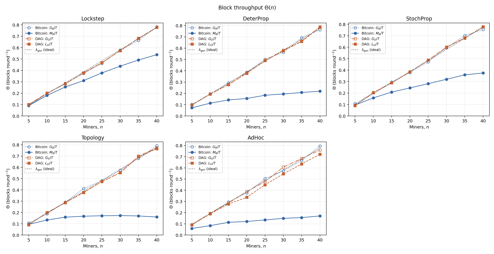
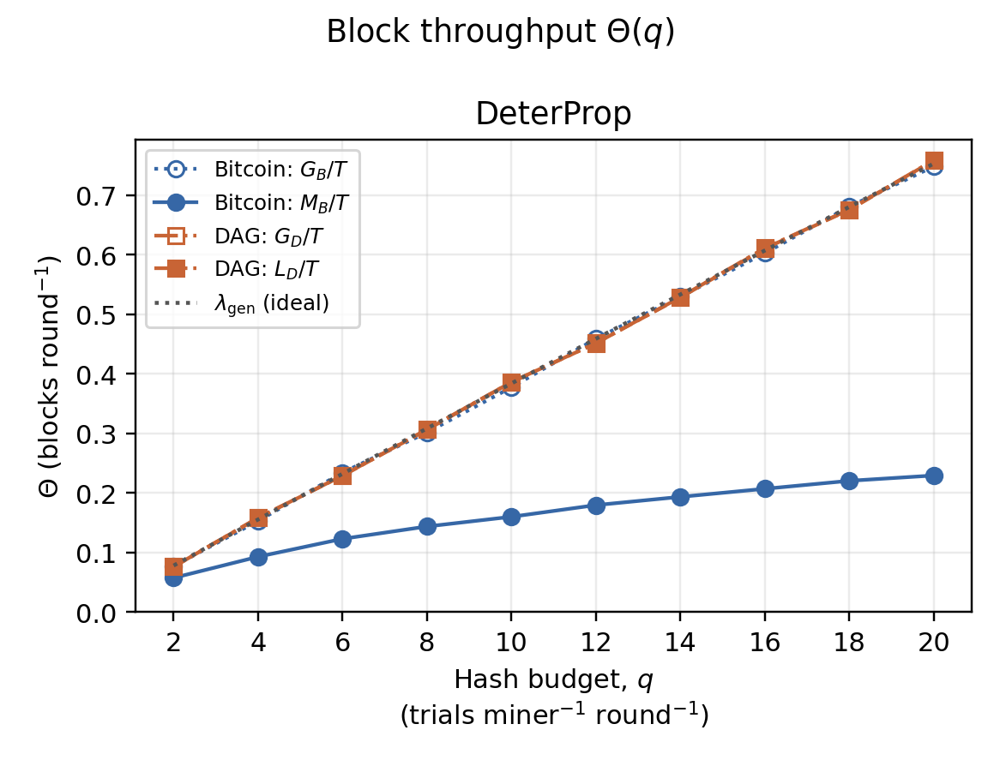
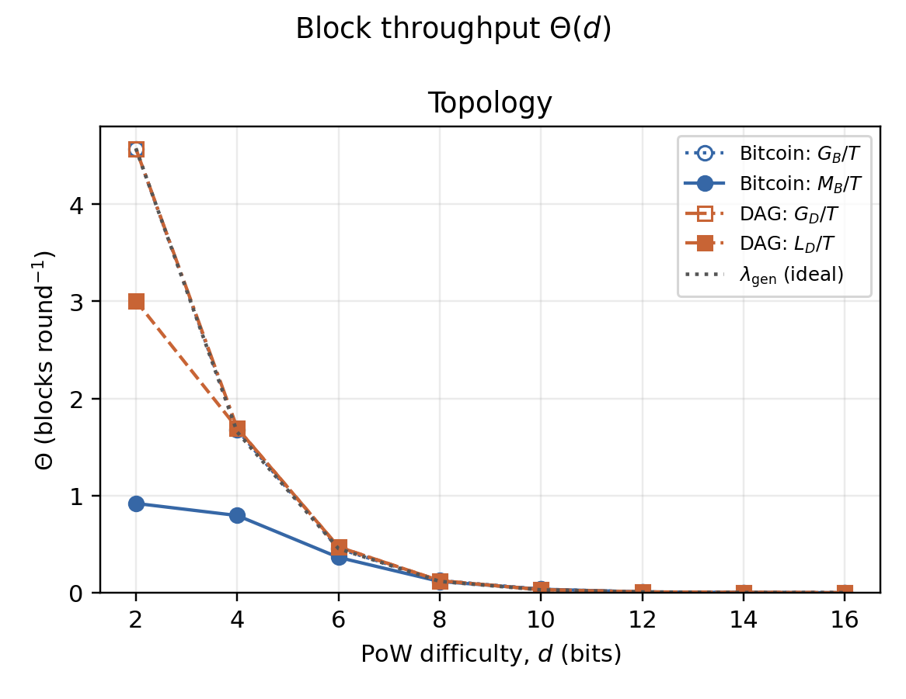
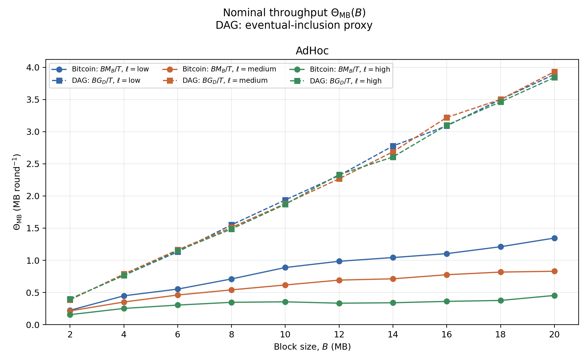
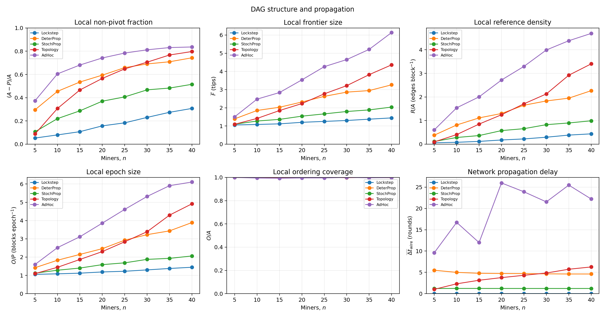
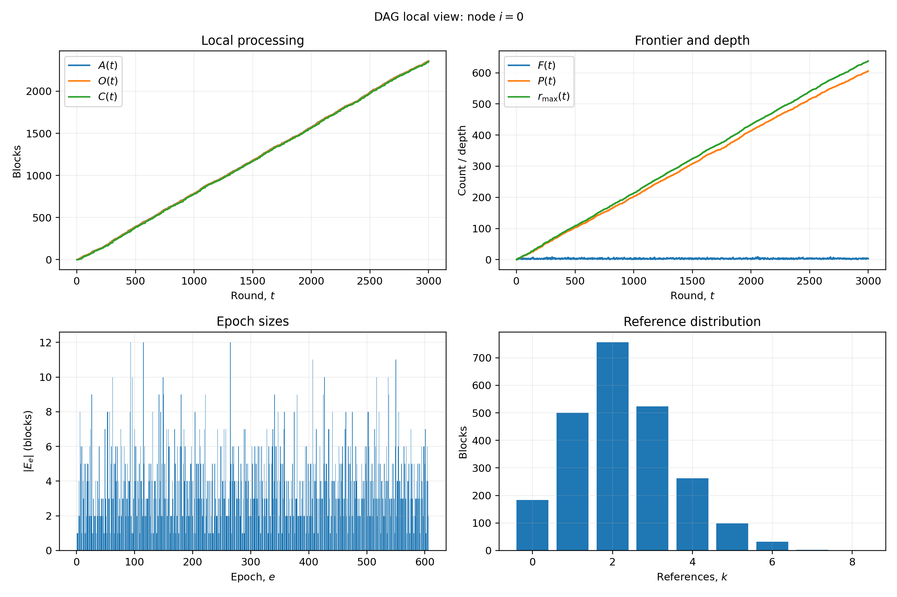

# 全诚实节点 DAG 仿真示例与统计分析

本文通过四组 Bitcoin 单链与 Conflux DAG 对照实验，分析矿工数量、哈希预算、挖矿难度和区块大小对吞吐量的影响，并通过旁支、tips、引用和 epoch 指标展示 DAG 的并发结构。各节提供实验参数、终端命令、结果图及分析；协议实现与完整参数说明见[开发指南](developer-guide.dag.zh.md)。

## 1. 模型与评价指标

Bitcoin 采用 `consensus.PoW` 最长链模型，DAG 采用 `consensus.ConfluxPoW`。两者均为全诚实节点，使用 equal 算力分配，关闭抽象 dataitem。吞吐量按区块数或名义容量统计，单位分别为 blocks/round 和 MB/round。

记 $T$ 为挖矿轮数，$G_B$、$G_D$ 为两模型生成的唯一普通块数，$M_B$ 为 Bitcoin 原生主链计数，$L_D$ 为 DAG 全节点当前全序的最长共同前缀长度，$B$ 为名义区块大小，单位为 MB。所有块数均排除创世块。

| 指标 | Bitcoin | Conflux DAG | 分析目标 |
|---|---|---|---|
| 全部生成吞吐 | $G_B/T$ | $G_D/T$ | 相同哈希预算下的产块能力 |
| 可利用吞吐 | $M_B/T$ | $G_D/T$ | 单链主链与 DAG 合法并发块的利用空间 |
| 截止时排序进度 | $M_B/T$ | $L_D/T$ | 原生主链计数与全网当前共同序的增长 |

DAG 的可利用吞吐以合法生成块经传播、持续扩展后纳入排序为前提，是衡量并发块利用空间的代理指标。$L_D/T$ 衡量挖矿截止时的全网排序一致进度，参考节点0的 $O_0/T$ 则描述本地排序进度；`pivot_depth` 给出随 pivot 重组可撤销的经验确认。

**Bitcoin 主链计数。** $M_B$ 沿用 ChainXim 原生统计：从全局观察链所选的最长链出发，与按本地主链高度选出的诚实节点求共同前缀。`consensus_miner_quantile=-1` 默认选择高度最高的一个诚实节点，设为1则选择全部诚实节点。

**DAG 共同序计数。** $L_D$ 在挖矿结束时逐位置比较所有节点 `protocol_view.order` 中的区块 hash，取最长共同前缀并排除创世块。该指标覆盖全部节点，与 Bitcoin 默认主链指标的节点选择范围有所区别。

前三组同轴绘制 $G_B/T$、$M_B/T$、$G_D/T$、$L_D/T$。区块大小组采用 $BM_B/T$ 与 $BG_D/T$，突出单链保留主链、DAG 利用合法旁支的结构差异。区块吞吐记为 $\Theta$，名义容量吞吐为 $\Theta_{\mathrm{MB}}=B\Theta$，$\ell$ 表示 low、medium、high 路损档位。

固定节点数 $n$、每节点每轮整数哈希预算 $q$、bit 难度 $d$ 时，挖矿目标为 `(2^256−1)>>d`。每节点每轮成功即停、最多产生一个块，理想生成率为：

$$\lambda_{\mathrm{gen}}=n\left[1-(1-p)^q\right],\qquad p=\frac{\mathrm{target}}{2^{256}}\approx2^{-d}.$$

当 $qp\ll1$ 时，$\lambda_{\mathrm{gen}}\approx nq2^{-d}$。前三组用精确预算公式绘制理想生成曲线。相同预算决定两模型接近的生成率，主链和共同序曲线进一步展示已生成区块的利用情况。

## 2. 实验配置与网络参数

### 2.1 实验参数

| 实验 | T | 节点数 n | 每节点 q | 难度 d | 名义 B | 扫描轴 / 网络 |
|---|---:|---:|---:|---:|---:|---|
| miners | 3000 | 5～40 | 5 | 8 | 1MB | n=5,10,…,40；五网络 |
| hashrate | 30000 | 10 | 2～20 | 8 | 1MB | q=2,4,…,20；DeterProp |
| difficulty | 3000 | 6 | 5 | 2～16 | 1MB | d=2,4,…,16；Topology |
| blocksize | 10000 | 10 | 5 | 8 | 2～20MB | B=2,4,…,20；AdHoc 三档 |

各点设置 `seed=7`。DAG 统一采用 `size_model=fixed_total`、`drain_rounds=0`、`confirmation_policy=pivot_depth`、`N=2`、`sync_interval=5`、`sync_batch_size=128`、`plot_miner_id=0`。`fixed_total` 将每个块的名义传输大小固定为 B；`drain_rounds=0` 使统计截止于挖矿结束。

### 2.2 网络设置

Lockstep、DeterProp 和 StochProp 按整块传播；Topology 和 AdHoc 进一步模拟邻居链路、传输带宽与排队，DAG 通过网络接口完成库存交换、依赖补齐和分片重组。

| 抽象传播网络 | 设置 |
|---|---|
| LockstepNetwork | 每轮结束广播完整块 |
| DeterPropNetwork | `prop_vector=[0.1,0.2,…,1.0]`，表示随延迟轮数增长的累计接收比例 |
| StochPropNetwork | `rcvprob_start=0.25、rcvprob_inc=0.25`，分别为初始接收概率和逐轮增长量 |

**TopologyNetwork。** 采用静态随机拓扑，启用续传，即 `dynamic=False、enable_resume_transfer=True`。`ave_degree` 控制目标邻居度，`bandwidth_honest` 为诚实链路的名义 MB/round，`outage_prob` 为链路中断概率。

| 实验 | `rand_mode` | `ave_degree` | `bandwidth_honest` | `outage_prob` |
|---|---|---:|---:|---:|
| 矿工数量 | homogeneous | 4 | 0.5 | 0.01 |
| 挖矿难度 | binomial | 4 | 5 | 0 |

矿工数量组固定目标邻居度，节点增多时相对连接密度下降；难度组在6节点随机拓扑上提高带宽，以观察高产块负载下的传播和排序。

**AdHocNetwork。** 节点在模型空间中移动，实际邻接由位置和通信范围决定。`region_width` 和 `comm_range` 使用相同空间单位，`move_variance` 为高斯位移尺度，`bandwidth_max` 为参考近距离的名义带宽，单位为 MB/round。

| 实验 | `ave_degree` | `region_width` | `comm_range` | `move_variance` | `bandwidth_max` | 路损档位 |
|---|---:|---:|---:|---:|---:|---|
| 矿工数量 | 2 | 100 | 70 | 1 | 5 | medium |
| 区块大小 | 3 | 100 | 30 | 5 | 100 | low / medium / high |

两组均随机初始化，设置 `outage_prob=0.01` 并开启大尺度衰落。low、medium、high 对应路损指数 $\alpha=0.8、1.0、1.2$。参考距离为 `comm_range/100`，非零距离上的名义带宽按 `bandwidth_max × (参考距离/链路距离)^α` 计算，并按整片传输取整。

开启衰落时，分片大小由 `bandwidth_max × 0.01^α` 确定，覆盖 INI 的 `segment_size`。区块大小组的三档分别约为2.5119、1.0000、0.3981MB；矿工数量组的 medium 档为0.05MB。三档比较同时体现距离衰减与分片粒度的变化。

### 2.3 命令使用

以下命令在仓库根目录执行。每组命令独立设置参数，依次运行仿真和绘图；修改 T、N、Q、D、B 及扫描数组即可调整实验。五种网络分别使用 `conf/conflux_*.ini`，通过 `--consensus_type` 切换两种模型。诚实运行设置 `--adver_num 0`，配置中的 `attack_type=HonestMining` 对应诚实挖矿。

`CX_RUN` 为 Python random 和 NumPy 设置外部种子，DAG 同时使用原生 `--seed`。`ROOT` 指定输出目录，每个参数点单独保存统计文件和 `run.log`。

默认 `DRAW_BITCOIN=0、DRAW_DAG=0`，采用 compact 输出，保留吞吐与共同前缀统计。将对应开关设为1后，`--no_compact_outputfile` 输出完整结构数据和链结构图；结构图渲染需要 Graphviz 的 `dot`。DAG 时序图使用完整输出。

## 3. 矿工数量与五网络吞吐

固定每节点 q=5、d=8、B=1MB，扫描 n=5,10,…,40。节点数增加时，全网总哈希预算随之增加。五种网络、两种模型共80个实验点。

```bash
(
export MPLBACKEND=Agg PYTHONDONTWRITEBYTECODE=1
CX_PY=python
DRAW_BITCOIN=0
DRAW_DAG=0
ROOT=Results/honest_cli_run01
T=3000; N=5; Q=5; D=8; B=1
MINERS=(5 10 15 20 25 30 35 40)
SEEDS=(7)
NETS=(LockstepNetwork DeterPropNetwork StochPropNetwork TopologyNetwork AdHocNetwork)
TOPO_DEGREE=4
CX_RUN='import os,random,runpy,sys; import numpy as np; seed=int(os.environ["CX_SEED"]); random.seed(seed); np.random.seed(seed); print("external_random_seed="+str(seed),flush=True); sys.argv=["main.py",*sys.argv[1:]]; runpy.run_path("main.py",run_name="__main__")'
for seed in "${SEEDS[@]}"; do
  for c in PoW ConfluxPoW; do
    model=Bitcoin; dag_args=()
    if [ "$c" = ConfluxPoW ]; then
      model=DAG
      dag_args=(--seed "$seed" --size_model fixed_total --drain_rounds 0
        --confirmation_policy pivot_depth --sync_interval 5 --sync_batch_size 128 --plot_miner_id 0)
    fi
    draw_structure=$DRAW_BITCOIN
    if [ "$model" = DAG ]; then
      draw_structure=$DRAW_DAG
    fi
    output_args=()
    if [ "$draw_structure" = 1 ]; then
      output_args=(--no_compact_outputfile)
    fi
    for net in "${NETS[@]}"; do
      net_args=()
      case "$net" in
        LockstepNetwork) config=conf/conflux_lockstep.ini ;;
        DeterPropNetwork) config=conf/conflux_deterprop.ini ;;
        StochPropNetwork)
          config=conf/conflux_stochprop.ini
          net_args=(--rcvprob_start 0.25 --rcvprob_inc 0.25) ;;
        TopologyNetwork)
          config=conf/conflux_topology.ini
          net_args=(--init_mode rand --rand_mode homogeneous --ave_degree "$TOPO_DEGREE"
            --bandwidth_honest 0.5 --bandwidth_adv 0.5 --outage_prob 0.01) ;;
        AdHocNetwork)
          config=conf/conflux_adhoc.ini
          net_args=(--init_mode rand --ave_degree 2 --region_width 100 --comm_range 70
            --move_variance 1 --outage_prob 0.01 --enable_large_scale_fading
            --path_loss_level medium --bandwidth_max 5) ;;
      esac
      for n in "${MINERS[@]}"; do
        out="$ROOT/miners/$model/$net/n$n/seed$seed"
        mkdir -p "$out"
        CX_SEED="$seed" "$CX_PY" -c "$CX_RUN" --config "$config" \
          --consensus_type "consensus.$c" --network_type "network.$net" \
          --miner_num "$n" --total_round "$T" --total_height 1000000000 --process_bar_type round \
          --q_ave "$Q" --q_distr equal --difficulty "$D" --blocksize "$B" -N 2 \
          --adver_num 0 --no_dataitem_enable --max_block_capacity 0 \
          "${output_args[@]}" "${net_args[@]}" "${dag_args[@]}" \
          --result_path "$out" 2>&1 | tee "$out/run.log"
      done
    done
  done
done
"$CX_PY" plot_honest_dag.py --results-root "$ROOT" --case miners --strict --theory --throughput both \
  --rounds "$T" --miners "$N" --q "$Q" --difficulty "$D" --blocksize "$B" \
  --miners-axis "${MINERS[@]}" --networks "${NETS[@]}" --seeds "${SEEDS[@]}" \
  --output-dir "$ROOT/figures/miners"
)
```



图1中，两模型生成率随 n 增加，接近理想生成率；n=40时理想值为0.7752 blocks/round。40节点结果如下，吞吐单位为 blocks/round：

| 网络 | $G_B/T$ | $M_B/T$ | $G_D/T$ | $L_D/T$ | $L_D/G_D$ |
|---|---:|---:|---:|---:|---:|
| Lockstep | 0.7823 | 0.5383 | 0.7780 | 0.7780 | 100.00% |
| DeterProp | 0.7630 | 0.2193 | 0.7877 | 0.7837 | 99.49% |
| StochProp | 0.7547 | 0.3750 | 0.7777 | 0.7773 | 99.96% |
| Topology | 0.7907 | 0.1597 | 0.7723 | 0.7650 | 99.05% |
| AdHoc | 0.7950 | 0.1703 | 0.7597 | 0.7213 | 94.95% |

DAG 将合法旁支纳入 epoch 排序，五种网络的共同序覆盖率为94.95%～100%；AdHoc 中2279个生成块有2164块进入全节点共同序。Bitcoin 的主链吞吐增长较缓，Topology 在较大节点数处趋平并略有回落，体现了并行竞争和传播延迟对单链区块利用率的影响。

## 4. 哈希预算与 DeterProp 吞吐

固定10节点、d=8、B=1MB、30000轮，扫描每节点每轮哈希预算 q=2,4,…,20。传播向量保持不变，共20个实验点。

```bash
(
export MPLBACKEND=Agg PYTHONDONTWRITEBYTECODE=1
CX_PY=python
DRAW_BITCOIN=0
DRAW_DAG=0
ROOT=Results/honest_cli_run01
T=30000; N=10; Q=5; D=8; B=1
HASHRATES=(2 4 6 8 10 12 14 16 18 20)
SEEDS=(7)
CX_RUN='import os,random,runpy,sys; import numpy as np; seed=int(os.environ["CX_SEED"]); random.seed(seed); np.random.seed(seed); print("external_random_seed="+str(seed),flush=True); sys.argv=["main.py",*sys.argv[1:]]; runpy.run_path("main.py",run_name="__main__")'
for seed in "${SEEDS[@]}"; do
  for c in PoW ConfluxPoW; do
    model=Bitcoin; dag_args=()
    if [ "$c" = ConfluxPoW ]; then
      model=DAG
      dag_args=(--seed "$seed" --size_model fixed_total --drain_rounds 0
        --confirmation_policy pivot_depth --sync_interval 5 --sync_batch_size 128 --plot_miner_id 0)
    fi
    draw_structure=$DRAW_BITCOIN
    if [ "$model" = DAG ]; then
      draw_structure=$DRAW_DAG
    fi
    output_args=()
    if [ "$draw_structure" = 1 ]; then
      output_args=(--no_compact_outputfile)
    fi
    for q in "${HASHRATES[@]}"; do
      out="$ROOT/hashrate/$model/DeterPropNetwork/q$q/seed$seed"
      mkdir -p "$out"
      CX_SEED="$seed" "$CX_PY" -c "$CX_RUN" --config conf/conflux_deterprop.ini \
        --consensus_type "consensus.$c" --network_type network.DeterPropNetwork \
        --miner_num "$N" --total_round "$T" --total_height 1000000000 --process_bar_type round \
        --q_ave "$q" --q_distr equal --difficulty "$D" --blocksize "$B" -N 2 \
        --adver_num 0 --no_dataitem_enable --max_block_capacity 0 \
        "${output_args[@]}" "${dag_args[@]}" --result_path "$out" 2>&1 | tee "$out/run.log"
    done
  done
done
"$CX_PY" plot_honest_dag.py --results-root "$ROOT" --case hashrate --strict --theory --throughput both \
  --rounds "$T" --miners "$N" --q "$Q" --difficulty "$D" --blocksize "$B" \
  --hashrate-axis "${HASHRATES[@]}" --seeds "${SEEDS[@]}" --output-dir "$ROOT/figures/hashrate"
)
```



图2中，增大 q 同时提高两模型的生成吞吐。DAG 共同序吞吐接近生成吞吐，Bitcoin 主链吞吐的增幅较小。代表点如下，吞吐单位为 blocks/round：

| q | Bitcoin生成 / 主链块数 | DAG生成 / 共同序块数 | $M_B/T$ | $L_D/T$ |
|---:|---:|---:|---:|---:|
| 2 | 2310 / 1718 | 2279 / 2278 | 0.05727 | 0.07593 |
| 10 | 11318 / 4797 | 11583 / 11581 | 0.15990 | 0.38603 |
| 20 | 22446 / 6876 | 22764 / 22751 | 0.22920 | 0.75837 |

q=20时，Bitcoin 主链占生成量的30.63%，DAG 共同序覆盖生成量的99.94%；对应吞吐分别为0.22920和0.75837 blocks/round。随着产块竞争增强，DAG 通过引用和 epoch 排序保持了较高的并发块利用率。

## 5. 挖矿难度与 Topology 吞吐

固定6节点、q=5、B=1MB、3000轮，扫描 bit 难度 d=2,4,…,16，共16个实验点。采用目标平均度4的 binomial 随机拓扑、5MB/round 诚实链路带宽和0中断概率。

```bash
(
export MPLBACKEND=Agg PYTHONDONTWRITEBYTECODE=1
CX_PY=python
DRAW_BITCOIN=0
DRAW_DAG=0
ROOT=Results/honest_cli_run01
T=3000; N=6; Q=5; D=8; B=1
DIFFICULTIES=(2 4 6 8 10 12 14 16)
SEEDS=(7)
TOPO_DEGREE=4
CX_RUN='import os,random,runpy,sys; import numpy as np; seed=int(os.environ["CX_SEED"]); random.seed(seed); np.random.seed(seed); print("external_random_seed="+str(seed),flush=True); sys.argv=["main.py",*sys.argv[1:]]; runpy.run_path("main.py",run_name="__main__")'
for seed in "${SEEDS[@]}"; do
  for c in PoW ConfluxPoW; do
    model=Bitcoin; dag_args=()
    if [ "$c" = ConfluxPoW ]; then
      model=DAG
      dag_args=(--seed "$seed" --size_model fixed_total --drain_rounds 0
        --confirmation_policy pivot_depth --sync_interval 5 --sync_batch_size 128 --plot_miner_id 0)
    fi
    draw_structure=$DRAW_BITCOIN
    if [ "$model" = DAG ]; then
      draw_structure=$DRAW_DAG
    fi
    output_args=()
    if [ "$draw_structure" = 1 ]; then
      output_args=(--no_compact_outputfile)
    fi
    for d in "${DIFFICULTIES[@]}"; do
      out="$ROOT/difficulty/$model/TopologyNetwork/d$d/seed$seed"
      mkdir -p "$out"
      CX_SEED="$seed" "$CX_PY" -c "$CX_RUN" --config conf/conflux_topology.ini \
        --consensus_type "consensus.$c" --network_type network.TopologyNetwork \
        --miner_num "$N" --total_round "$T" --total_height 1000000000 --process_bar_type round \
        --q_ave "$Q" --q_distr equal --difficulty "$d" --blocksize "$B" -N 2 \
        --init_mode rand --rand_mode binomial --ave_degree "$TOPO_DEGREE" \
        --bandwidth_honest 5 --bandwidth_adv 5 --outage_prob 0 \
        --adver_num 0 --no_dataitem_enable --max_block_capacity 0 \
        "${output_args[@]}" "${dag_args[@]}" --result_path "$out" 2>&1 | tee "$out/run.log"
    done
  done
done
"$CX_PY" plot_honest_dag.py --results-root "$ROOT" --case difficulty --strict --theory --throughput both \
  --rounds "$T" --miners "$N" --q "$Q" --difficulty "$D" --blocksize "$B" \
  --difficulty-axis "${DIFFICULTIES[@]}" --seeds "${SEEDS[@]}" --output-dir "$ROOT/figures/difficulty"
)
```



图3中，难度增大使挖矿目标减小，生成吞吐随之下降。d=2时，Bitcoin 生成13713块、主链计2759块，对应4.5710和0.9197 blocks/round；DAG 生成13719块、共同序9021块，对应4.5730和3.0070 blocks/round。此时理想生成率为 `6×[1−(3/4)^5]≈4.5762` blocks/round，与两模型的生成量接近。

低难度也提高了同步负载：d=2时 DAG 参考节点已排序13716块，全网共同序覆盖率为65.76%，已完成接收配对的平均延迟为116.16轮，另有7798个配对待完成。d=4时生成5089块、共同序5086块；d=6～12时共同序等于生成量。随着产块负载下降，跨节点排序进度逐步接近全局生成进度。d=16时理论预期为1.37块，Bitcoin 和 DAG 分别生成0块和1块，表现出低产块率下的离散波动。

## 6. 区块大小与 AdHoc 三档名义吞吐

固定10节点、q=5、d=8、10000轮，扫描 B=2,4,…,20MB 及三档路损，共60个实验点。网络采用区域100、通信范围30、平均度参数3、移动尺度5和最大带宽100MB/round。图中以颜色区分路损，以线型和标记区分模型，同轴比较 $BM_B/T$ 与 $BG_D/T$，单位为 MB/round。

```bash
(
export MPLBACKEND=Agg PYTHONDONTWRITEBYTECODE=1
CX_PY=python
DRAW_BITCOIN=0
DRAW_DAG=0
ROOT=Results/honest_cli_run01
T=10000; N=10; Q=5; D=8; B=2
SIZES=(2 4 6 8 10 12 14 16 18 20)
LOSSES=(low medium high)
SEEDS=(7)
CX_RUN='import os,random,runpy,sys; import numpy as np; seed=int(os.environ["CX_SEED"]); random.seed(seed); np.random.seed(seed); print("external_random_seed="+str(seed),flush=True); sys.argv=["main.py",*sys.argv[1:]]; runpy.run_path("main.py",run_name="__main__")'
for seed in "${SEEDS[@]}"; do
  for c in PoW ConfluxPoW; do
    model=Bitcoin; dag_args=()
    if [ "$c" = ConfluxPoW ]; then
      model=DAG
      dag_args=(--seed "$seed" --size_model fixed_total --drain_rounds 0
        --confirmation_policy pivot_depth --sync_interval 5 --sync_batch_size 128 --plot_miner_id 0)
    fi
    draw_structure=$DRAW_BITCOIN
    if [ "$model" = DAG ]; then
      draw_structure=$DRAW_DAG
    fi
    output_args=()
    if [ "$draw_structure" = 1 ]; then
      output_args=(--no_compact_outputfile)
    fi
    for loss in "${LOSSES[@]}"; do
      for b in "${SIZES[@]}"; do
        b_tag=$("$CX_PY" -c 'import sys; from plot_honest_dag import axis_number; print(axis_number(sys.argv[1]))' "$b")
        out="$ROOT/blocksize/$model/AdHocNetwork/$loss/b$b_tag/seed$seed"
        mkdir -p "$out"
        CX_SEED="$seed" "$CX_PY" -c "$CX_RUN" --config conf/conflux_adhoc.ini \
          --consensus_type "consensus.$c" --network_type network.AdHocNetwork \
          --miner_num "$N" --total_round "$T" --total_height 1000000000 --process_bar_type round \
          --q_ave "$Q" --q_distr equal --difficulty "$D" --blocksize "$b" -N 2 \
          --init_mode rand --ave_degree 3 --region_width 100 --comm_range 30 \
          --move_variance 5 --outage_prob 0.01 --enable_large_scale_fading \
          --path_loss_level "$loss" --bandwidth_max 100 \
          --adver_num 0 --no_dataitem_enable --max_block_capacity 0 \
          "${output_args[@]}" "${dag_args[@]}" --result_path "$out" 2>&1 | tee "$out/run.log"
      done
    done
  done
done
"$CX_PY" plot_honest_dag.py --results-root "$ROOT" --case blocksize --strict --throughput eventual \
  --rounds "$T" --miners "$N" --q "$Q" --difficulty "$D" --blocksize "$B" \
  --blocksize-axis "${SIZES[@]}" --losses "${LOSSES[@]}" --seeds "${SEEDS[@]}" \
  --output-dir "$ROOT/figures/blocksize"
)
```



图4中，DAG 在各路损档位的生成块率相近，名义可利用吞吐随 B 近似线性增长。Bitcoin 主链名义吞吐增长较缓，且随路损增强而降低，体现了大区块传播期间分叉竞争对主链利用率的影响。

B=20MB 的结果如下；$O_0$ 为参考节点排序块数：

| 路损 | $BM_B/T$ | $BG_D/T$ | $G_D$ | $O_0$ | $L_D$ | $L_D/G_D$ |
|---|---:|---:|---:|---:|---:|---:|
| low | 1.346 | 3.890 | 1945 | 1935 | 1917 | 98.56% |
| medium | 0.830 | 3.932 | 1966 | 1936 | 1829 | 93.03% |
| high | 0.454 | 3.842 | 1921 | 1369 | 526 | 27.38% |

三档 DAG 可利用吞吐约为3.8～3.9MB/round，共同序覆盖率则随路损增强从98.56%降至27.38%。high 档的参考节点接纳1371块、排序1369块，已完成接收配对平均延迟874.11轮，另有2311个配对待完成。DAG 保留了合法并发块的利用空间，较强路损下的传播积压则推迟了这些块进入全网共同序的时间。

## 7. DAG 并发特征与时序

### 7.1 五网络下的结构特征

本节使用矿工数量实验的40个 DAG 点。记 $A$ 为参考节点0接纳的普通块数，$P$ 为 pivot 高度，$O$ 为当前排序普通块数，$R$ 为引用边数，$F$ 为 tips 数。前五项取参考节点视角，传播延迟取全网已完成的“已发布块—非生产者接收节点”配对。



| 图5指标 | 定义与含义 |
|---|---|
| $(A-P)/A$ | 旁支率，表示接纳块中非 pivot 块的比例，包含已排序和未排序旁支 |
| $\overline F$ | 挖矿轮末 tips 数的时间平均，描述并行前沿规模 |
| $R/A$ | 每个接纳块的平均引用边数，主父边单独计数 |
| $O/P$ | 每个非创世 epoch 平均纳入的块数 |
| $O/A$ | 本地接纳图的排序覆盖率，未分配 epoch 的块数为 A−O |
| $\overline{\Delta t}_{\mathrm{wire}}$ | 已发布块到非生产者诚实节点完整接收的平均轮数 |

时间平均按 `receive_end_round` 等权采样，分母为0的比例记为空值。40节点结果如下，比例以百分比表示，传播延迟单位为 rounds：

| 网络 | $(A-P)/A$ | $\overline F$ | $R/A$ | $O/P$ | $O/A$ | $\overline{\Delta t}_{\mathrm{wire}}$ |
|---|---:|---:|---:|---:|---:|---:|
| Lockstep | 30.76% | 1.445 | 0.438 | 1.444 | 100.00% | 0.000 |
| DeterProp | 74.32% | 3.263 | 2.267 | 3.891 | 99.92% | 4.613 |
| StochProp | 51.52% | 2.040 | 0.991 | 2.062 | 99.96% | 1.216 |
| Topology | 79.71% | 4.361 | 3.403 | 4.917 | 99.78% | 6.269 |
| AdHoc | 83.65% | 6.135 | 4.693 | 6.108 | 99.87% | 22.228 |

节点数增加时，旁支率、平均 tips、引用密度和平均 epoch 大小总体上升，展示了并发前沿通过引用逐步合并、进入 epoch 的过程。40节点 AdHoc 的平均 tips 为6.135、每块平均引用4.693条边、平均 epoch 大小为6.108块，并发程度高于其余四种网络。

各网络的本地排序覆盖率接近1。40节点 AdHoc 中，节点0接纳2269块、排序2266块，本地覆盖率为99.87%；全局生成2279块，全节点共同序2164块，覆盖率为94.95%。这两项分别展示本地排序覆盖程度和跨节点的一致进度。其已完成配对平均传播延迟为22.23轮，另有984个配对待完成。

### 7.2 DeterProp 中的节点状态轨迹

图6展示 DeterProp、40节点、3000轮、q=5、d=8、B=1MB 时参考节点0的状态。时序图需要运行时开启 `DRAW_DAG=1` 或 `--no_compact_outputfile`，以保存逐轮历史和末态结构。



| 图6面板 | 内容 |
|---|---|
| $A(t)$、$O(t)$、$C(t)$ | 轮末接纳量、当前排序量、当前经验确认量；排序与确认随 pivot 视图更新 |
| $F(t)$、$P(t)$、$r_{\max}(t)$ | 前沿数、pivot 深度和全部依赖的最长路径深度 |
| $\lvert E_e\rvert$ | 末态各非创世 epoch 的块数 |
| 引用数 $k$ | 末态每个接纳普通块的引用数分布，0表示仅有主父 |

该实验生成2363块，节点0接纳2360块、排序2358块、经验确认2352块，全节点共同序为2351块。接纳、排序与确认曲线紧密跟随，表明该配置下节点处理进度与区块到达进度接近。

末态 pivot 高度606、最大 rank 638、tips 数为3；606个非创世 epoch 平均纳入3.891块，最大纳入12块。183个接纳块仅有主父，其余块带有 reference。尚未分配 epoch 的两个接纳块位于当前 pivot 尾的 Past 之外，等待后续 pivot 扩展纳入。逐轮状态、epoch 大小和引用分布见配套 CSV。

```bash
ROOT=Results/honest_cli_run01
TRACE="$ROOT/miners/DAG/DeterPropNetwork/n40/seed7"
python plot_honest_dag.py --results-root "$ROOT" --case dag --strict \
  --rounds 3000 --miners 10 --q 5 --difficulty 8 --blocksize 1 \
  --miners-axis 5 10 15 20 25 30 35 40 --seeds 7 \
  --trace-result "$TRACE" --output-dir "$ROOT/figures/dag"
```

`--case dag` 生成矿工数量实验的特征图，`--trace-result` 选择时序图对应的完整运行。单点时序也可通过 `plot_trace(folder, out)` 接口绘制，详见开发指南。

## 8. 结果文件与绘图

### 8.1 输出结构

```text
Results/<experiment>/
  miners/{Bitcoin,DAG}/{网络}/n{节点数}/seed{种子}/
  hashrate/{Bitcoin,DAG}/DeterPropNetwork/q{预算}/seed{种子}/
  difficulty/{Bitcoin,DAG}/TopologyNetwork/d{难度}/seed{种子}/
  blocksize/{Bitcoin,DAG}/AdHocNetwork/{档位}/b{MB}/seed{种子}/
  figures/{miners,hashrate,difficulty,blocksize,dag}/
    *.png / *.pdf
    observations.csv
    plot_audit.json
```

`parameters.txt` 保存运行参数，`evaluation results.txt` 保存统计结果，`run.log` 保存终端日志。DAG 另有参数与输出清单 `run_manifest.json`、统计摘要 `dag_metrics.json`，完整输出包含 `Chain Data` 中的结构和事件文件。

Bitcoin 结构图为 `blockchain_visualization/Blockchain Structure.gv.svg`；DAG 全局图和参考节点图分别为 `Chain Data/dag_structure.svg`、`Chain Data/dag_structure_node0.svg`。

DAG 的 `common_order_at_mining_end` 保存挖矿结束时的 $L_D$，`block_throughput_common_order` 为 $L_D/T$；`common_order` 保存观察结束时的共同前缀。本例 `drain_rounds=0`，两种计数相同。compact 输出包含这些计数，可直接绘制共同序吞吐。

| `observations.csv` 字段 | 含义 |
|---|---|
| `case/protocol/network/loss/x/path` | 实验组、模型、网络、路损、横轴及结果目录 |
| `miners/q/difficulty/blocksize/rounds/seed` | 实验参数 |
| `generated/total_round` | 生成块数 G 与挖矿轮数 T |
| `total_blocks_per_round/total_MB_per_round` | G/T 与 BG/T |
| `ledger_kind/ledger_blocks` | Bitcoin 原生主链 M_B 或 DAG 全节点共同序 L_D |
| `ledger_blocks_per_round/ledger_MB_per_round` | M_B/T、L_D/T 及相应名义 MB 吞吐 |
| `eventual_kind/eventual_blocks`、`eventual_*_per_round` | 可利用吞吐：Bitcoin 取 M_B，DAG 取 G_D |
| `common_order_blocks/common_order_source` | DAG 共同前缀计数及读取方式 |
| `reference_ordered_at_mining_end`、`reference_ordered_*_per_round` | 参考节点排序量及吞吐 |
| `expected_blocks_per_round` | 理想生成率 |
| `accepted/ordered/confirmed/pivot_height` 等 | DAG 节点状态和结构指标 |

绘图器按声明参数读取结果，`--strict` 检查实验点完整性。`plot_audit.json` 记录参数矩阵、网络设置、指标口径与输入摘要。图表及配套 CSV 见 [doc/dag](doc/dag)，其中 DAG 子目录保存逐轮状态、epoch 大小、引用分布和末态摘要。

### 8.2 离线绘图

以下命令分别绘制四组对比图；参数与第2节一致。

```bash
export MPLBACKEND=Agg
ROOT=Results/honest_cli_run01
python plot_honest_dag.py --results-root "$ROOT" --case miners --strict --theory --throughput both \
  --rounds 3000 --miners 5 --q 5 --difficulty 8 --blocksize 1 \
  --miners-axis 5 10 15 20 25 30 35 40 --seeds 7 --output-dir "$ROOT/figures/miners"
python plot_honest_dag.py --results-root "$ROOT" --case hashrate --strict --theory --throughput both \
  --rounds 30000 --miners 10 --q 5 --difficulty 8 --blocksize 1 \
  --hashrate-axis 2 4 6 8 10 12 14 16 18 20 --seeds 7 --output-dir "$ROOT/figures/hashrate"
python plot_honest_dag.py --results-root "$ROOT" --case difficulty --strict --theory --throughput both \
  --rounds 3000 --miners 6 --q 5 --difficulty 8 --blocksize 1 \
  --difficulty-axis 2 4 6 8 10 12 14 16 --seeds 7 --output-dir "$ROOT/figures/difficulty"
python plot_honest_dag.py --results-root "$ROOT" --case blocksize --strict --throughput eventual \
  --rounds 10000 --miners 10 --q 5 --difficulty 8 --blocksize 2 \
  --blocksize-axis 2 4 6 8 10 12 14 16 18 20 --losses low medium high --seeds 7 \
  --output-dir "$ROOT/figures/blocksize"
```

前三组输出 `{case}_throughput_comparison_blocks.png/.pdf`，区块大小组输出 `blocksize_eventual_throughput_MB.png/.pdf`。`--throughput` 选择统计口径：

| 选项 | 比较指标 |
|---|---|
| `both` | 前三组绘制四条曲线；区块大小组三档各绘制 $BM_B/T$ 与 $BG_D/T$ |
| `eventual` | $M_B/T$ 与 $G_D/T$，区块大小组再乘 B |
| `total` | $G_B/T$ 与 $G_D/T$ |
| `ledger` | $M_B/T$ 与 $L_D/T$ |

`--theory` 为生成吞吐添加理想参照线，用于前三组的 `both` 或显式 `total`。各组使用独立的固定参数与扫描轴；`--grid` 也可从矩阵文件读取实验设置。

## 9. 扩展实验

研究网络扩容时，可在增加节点数的同时固定全网总哈希预算，以分离算力增长和网络规模的影响。研究引用头开销时，可将 `size_model` 改为 `body_plus_header`，观察引用数量对传输成本的作用。

研究持续负载下的性能时，可延长 T，并按固定窗口统计生成率、排序增量、共同序增量、tips 和传输积压，观察运行过程的稳定性；高难度实验可依据 $T\lambda_{\mathrm{gen}}$ 调整轮数，获得足够的出块观测。多种子实验可汇总均值和观测范围，绘图阴影表示各 seed 的最小值至最大值。传播收敛实验可单独设置排空轮，并分别报告挖矿截止与观察截止状态。

## 10. 单点观察与数据项示例

下面的命令生成一个便于观察的小规模 DAG。更换 `conflux_lockstep/deterprop/stochprop/topology/adhoc.ini` 可选择其他网络。

```bash
python main.py --config conf/conflux_lockstep.ini \
  --miner_num 4 --total_round 80 --q_ave 1 --difficulty 3 --blocksize 0.1 \
  --confirmation_policy pivot_depth -N 2 --seed 7 --plot_miner_id 0 \
  --no_compact_outputfile --result_path Results/dag_observe
```

将共识改为 `--consensus_type consensus.PoW` 并另设 `result_path`，即可运行单链对照。完整 DAG 结果支持离线重放：

```bash
python -m util.dag_replay --result_path Results/dag_observe --replay
```

在任一 DAG 网络配置上均可启用抽象数据项：

```bash
python main.py --config conf/conflux_lockstep.ini \
  --miner_num 4 --total_round 200 --q_ave 5 --difficulty 8 \
  --dataitem_enable --max_block_capacity 4 --dataitem_size 1 --dataitem_input_interval 2 \
  --confirmation_policy pivot_depth -N 2 --seed 7 \
  --no_compact_outputfile --result_path Results/dag_dataitems
```

dataitem 使用8字节身份标识，`dataitem_size` 表示整数名义 MB/项，块大小由打包项数决定。`dataitem_input_interval>0` 使用周期本地池，设为0使用全局输入池。启用后按唯一排序或确认的数据项统计吞吐。原单链的其他共识与攻击实例见[仿真示例](simulation-example.zh.md)。
